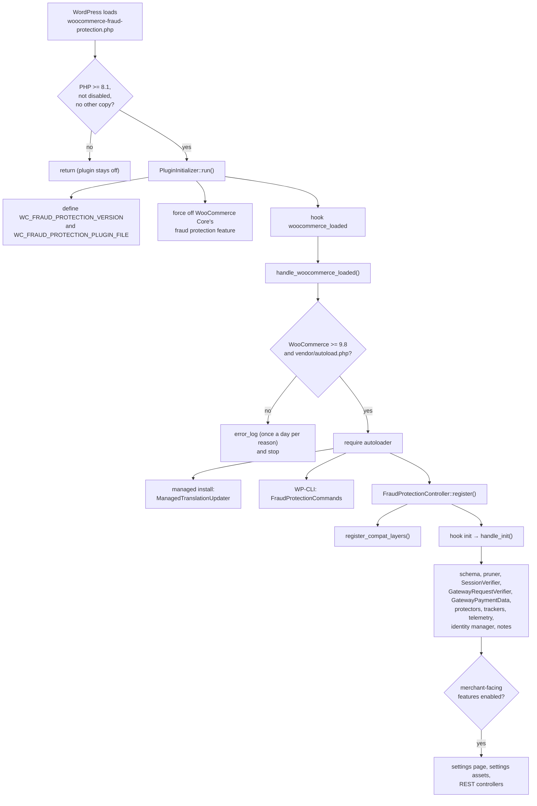

# Architecture

This reference describes how the plugin's code is organized, how it starts, how its components get their dependencies, and every WordPress, WooCommerce and third-party hook it uses. For the reasoning behind the design, read [chapter 3 of the tutorial](../tutorial/03-fraud-protection.md) first.

## Contents

- [Source layout](#source-layout)
- [Startup sequence](#startup-sequence)
- [Kill switches and copies](#kill-switches-and-copies)
- [Components and dependency injection](#components-and-dependency-injection)
- [Registration timing](#registration-timing)
- [Hook map](#hook-map)
- [Public and internal code](#public-and-internal-code)

## Source layout

```text
woocommerce-fraud-protection/
├── woocommerce-fraud-protection.php         Main plugin file (kill switches, copy detection)
├── woocommerce-fraud-protection-loader.php  MU-plugin loader for managed installations
├── src/
│   ├── FraudProtection/                     Public API (Automattic\WooCommerce\FraudProtection)
│   │   └── Schemas/                         Public value objects and enums
│   └── Internal/FraudProtectionPlugin/      Internal code
│       ├── Protectors/                      WooCommerce flows: checkouts, pay for order, add payment method
│       ├── Trackers/                        Cart, checkout, order and payment-method events
│       ├── Compat/                          Gateway and extension compatibility layers
│       ├── Rules/                           Merchant rules: storage, evaluation, REST
│       ├── Sessions/                        Attempts log, identity cookie, data collection, REST
│       ├── Settings/                        Settings page, automatic protection, REST, telemetry
│       ├── Database/                        Schema installation and upgrades
│       ├── CLI/                             WP-CLI commands
│       ├── Logging/                         Logger and platform-log sanitizer
│       ├── Notes/                           WooCommerce Inbox notes
│       └── Schemas/                         Internal DTOs and enums
├── assets/                                  Browser scripts and styles served as-is
├── client/                                  React + TypeScript settings app, built into build/
├── examples/                                Reference integrations exercised by the tests
├── tests/php/, tests/js/                    PHPUnit and Jest tests
└── docs/                                    This documentation
```

Composer maps `Automattic\WooCommerce\` to `src/`, so classes load on first use.

## Startup sequence



Notes:

- `PluginInitializer` disables WooCommerce Core's own `fraud_protection` feature at priority 999. Core has its own implementation of the same idea, and running both would cause session and script conflicts.
- The WooCommerce version check is enforced at runtime because an MU-plugin bypasses WordPress's `Requires Plugins` header.
- `FraudProtectionController::feature_is_enabled()` always returns `true`. It's kept as the single feature gate at the start of `register()`; components must not repeat it.

## Kill switches and copies

`woocommerce-fraud-protection.php` must stay parseable on PHP 7.4 and 8.0, because it runs before the version check. It returns early when:

- PHP is older than 8.1;
- the constant `WC_FRAUD_PROTECTION_DISABLED` is `true`;
- `WC_FRAUD_PROTECTION_VERSION` is already defined (another copy is running);
- it's the MU-plugin copy and an active regular copy exists. The MU copy always yields.

`woocommerce-fraud-protection-loader.php` is the MU-plugin loader for managed installations. It requires the main file from `mu-plugins/woocommerce-fraud-protection/`, and only when the MU copy actually started, it fixes asset URLs for the symlinked location and defines `WC_FRAUD_PROTECTION_MANAGED_INSTALL`. A managed install loads translations from `WP_LANG_DIR/woocommerce-fraud-protection/` and keeps them current with `ManagedTranslationUpdater`.

CI lints the two entry files and runs the PHP version kill-switch scenario on PHP 7.4 and 8.0 (`php-lint-test.yml`). The other smoke scenarios under `tests/php/smoke/` run on PHP 8.1.

## Components and dependency injection

Every component is resolved from the WooCommerce container, `wc_get_container()`. The container is WooCommerce's own: it autowires classes in the `Automattic\WooCommerce\` namespace, and the plugin's classes live there.

The pattern every component follows:

```php
class MyComponent {
	private SessionVerifier $session_verifier;

	/**
	 * @internal
	 */
	final public function init( SessionVerifier $session_verifier ): void {
		$this->session_verifier = $session_verifier;
	}

	public function register(): void {
		add_action( 'some_hook', array( $this, 'handle_some_hook' ) );
	}

	/**
	 * @internal
	 */
	public function handle_some_hook(): void {
		// ...
	}
}
```

- The container calls `init()` with the resolved dependencies. Constructors take no required parameters.
- Resolved instances are shared: `wc_get_container()->get( X::class )` returns the same instance every time. This is how, for example, `GatewayRequestVerifier` keeps the reference readers that gateways registered.
- `FraudProtectionController` owns registration. A new component is added to `register_compat_layers()` or `handle_init()`, not registered by itself.
- WP-CLI commands register from `PluginInitializer`, outside the controller.
- `FraudProtectionController::log()` is a static facade over `FraudProtectionLogger`. It works once the controller has been resolved, which happens at `woocommerce_loaded`.

## Registration timing

| When | What registers | Why |
|------|----------------|-----|
| Plugin file load | Kill switches, Core feature filter, `woocommerce_loaded` hook | Before anything else, and without autoloading |
| `woocommerce_loaded` | Compatibility layers, managed translation updates, and the WP-CLI `after_wp_load` callback that adds the commands | Gateways fire some hooks before `init`; WooCommerce's container is ready |
| `init` (default priority) | Everything else | Matches when WooCommerce initializes the session, cart and gateways |
| `init` priority 0 | Managed translation loading | Translations must load before any string is used |

Two consequences:

- **Gateway instances don't exist at registration time.** `WC()->payment_gateways()` initializes them later. Anything that asks a gateway about itself, such as `GatewayNativeSupport::declared()`, must run inside a hook callback.
- **Hook priorities are intentional.** For example, `ShortcodeCheckoutProtector` registers its verifier from `woocommerce_checkout_process` so it attaches only during a real checkout, and runs at `PHP_INT_MAX` so it sees every other validator's errors. Follow the nearest existing component when adding a hook.

## Hook map

Every hook the plugin attaches to, grouped by purpose. Priority is 10 unless stated.

### Bootstrap

| Hook | Type | Component | Purpose |
|------|------|-----------|---------|
| `woocommerce_feature_fraud_protection_enabled` (999) | filter | `PluginInitializer` | Turn off WooCommerce Core's built-in feature |
| `woocommerce_loaded` | action | `PluginInitializer` | Start the plugin |
| `init` | action | `FraudProtectionController` | Register first-party components |
| `init` (0) | action | `PluginInitializer` | Load managed translations |
| `plugins_url` (0) | filter | MU-plugin loader | Fix asset URLs on managed installations |
| `after_wp_load` (WP-CLI) | action | `FraudProtectionCommands` | Add the WP-CLI commands |

### Verification and enforcement

| Hook | Type | Component | Purpose |
|------|------|-----------|---------|
| `woocommerce_store_api_checkout_update_order_from_request` | action | `BlocksCheckoutProtector` | Keep the Store API request data for this request |
| `woocommerce_store_api_checkout_order_processed` | action | `BlocksCheckoutProtector` | Verify; throw `RouteException` on a block |
| `woocommerce_checkout_process` (`PHP_INT_MAX`) | action | `ShortcodeCheckoutProtector` | Attach the validator for this checkout |
| `woocommerce_after_checkout_validation` (`PHP_INT_MAX`) | action | `ShortcodeCheckoutProtector` | Verify; add a `WP_Error` on a block |
| `woocommerce_before_pay_action` | action | `PayForOrderProtector` | Verify; add an error notice on a block |
| `woocommerce_add_payment_method_form_is_valid` | filter | `AddPaymentMethodProtector` | Verify; return `false` on a block |
| `woocommerce_checkout_order_created` | action | `SessionVerifier` | Copy the session ID to the new classic-checkout order |
| `woocommerce_fraud_protection_skip_session_verify` | filter | `GatewayRequestVerifier`, `PayPalDecisionReuse`, `StripeSetupIntentCompat`, `WcposCompat` | Supply a decision kept from an earlier request, or the POS decision |
| `woocommerce_fraud_protection_resolved_payment_data` | filter | `GatewayPaymentData`, payment-data compatibility layers | Resolve the payment instrument |

### Script loading

| Hook | Type | Component | Purpose |
|------|------|-----------|---------|
| `woocommerce_blocks_enqueue_checkout_block_scripts_before` | action | `BlocksCheckoutProtector` | Load `blocks-checkout.js` |
| `woocommerce_checkout_before_order_review`, `woocommerce_checkout_order_review` | action | `ShortcodeCheckoutProtector` | Load `shortcode-checkout.js`; the second covers templates that fire only it |
| `before_woocommerce_pay_form` | action | `PayForOrderProtector` | Load `pay-for-order.js` |
| `woocommerce_add_payment_method_form_bottom` | action | `AddPaymentMethodProtector` | Load `add-payment-method.js` |
| `woocommerce_add_payment_method_form_bottom` (20) | action | `StripeSetupIntentCompat` | Load `stripe-add-payment-method.js` |
| `wp_enqueue_scripts` (`PHP_INT_MAX`) | action | `ExpressCheckoutScriptCompat` | Load `express-checkout.js` where express buttons are enqueued |
| PayPal render hooks, mini-cart hooks, `woocommerce_blocks_enqueue_checkout_block_scripts_before` and `woocommerce_blocks_enqueue_cart_block_scripts_before`, `wp_enqueue_scripts` (mostly at priority 20) | action/filter | `PayPalScriptCompat` | Load `paypal-express.js` on PayPal surfaces, and `blocks-checkout.js` on the Cart block |
| `woocommerce_subscriptions_change_payment_after_submit` | action | `SubscriptionsChangePaymentCompat` | Load `pay-for-order.js` on the change-payment-method form |

### Third-party flows

| Hook | Type | Component | Purpose |
|------|------|-----------|---------|
| `woocommerce_paypal_payments_create_order_request_started` | action | `PayPalCompat` | Verify the create-order request |
| `woocommerce_paypal_payments_paypal_order_created` | action | `PayPalCompat` | Tie the PayPal order to the verification |
| `woocommerce_paypal_payments_woocommerce_order_created_from_cart` | action | `PayPalCompat` | Store the session ID on the WooCommerce order |
| `ppcp_request_args` | filter | `PayPalCompat` | Verify setup-token and vault-order requests to PayPal |
| `wc_stripe_is_valid_create_and_confirm_setup_intent_captcha` | filter | `StripeSetupIntentCompat` | Verify the setup-intent request |
| `woocommerce_subscription_change_payment_method_via_pay_shortcode` | action | `SubscriptionsChangePaymentCompat` | Verify the change-payment-method form |

### Data collection

| Hook | Type | Component | Purpose |
|------|------|-----------|---------|
| `internal_woocommerce_cart_item_{added,updated,removed}_from_user_request` | action | `CartEventTracker` | Record cart changes made by the shopper |
| `woocommerce_cart_item_restored` | action | `CartEventTracker` | Record a restored item |
| `template_redirect` | action | `CartEventTracker`, `CheckoutEventTracker` | Record cart and checkout page loads |
| `woocommerce_checkout_update_order_review` | action | `CheckoutEventTracker` | Record classic checkout field updates |
| `woocommerce_store_api_checkout_update_customer_from_request` | action | `CheckoutEventTracker` | Record block checkout updates |
| `woocommerce_checkout_order_processed`, `woocommerce_store_api_checkout_order_processed` | action | `CheckoutEventTracker` | Record an order placed |
| `woocommerce_order_status_changed` | action | `CheckoutEventTracker` | Clear the events once the order is paid |
| `before_woocommerce_add_payment_method` | action | `PaymentMethodEventTracker` | Record an add-payment-method page load |
| `woocommerce_new_payment_token` | action | `PaymentMethodEventTracker` | Record a saved payment method |
| `woocommerce_set_cookie_options` | filter | `SessionIdentityManager` | Set `SameSite` on the identity cookie |

### Admin and maintenance

| Hook | Type | Component | Purpose |
|------|------|-----------|---------|
| `woocommerce_get_settings_pages` | filter | `FraudProtectionController` | Add the Fraud prevention settings tab |
| `admin_enqueue_scripts` | action | `FraudProtectionController` | Load the settings app |
| `woocommerce_admin_get_user_data_fields` | filter | `FraudProtectionController` | Allow the plugin's per-user preferences |
| `admin_init` | action | Notes | Add, update or retire Inbox notes |
| `add_option_`, `update_option_`, `delete_option_` for the automatic-protection and merchant-facing options | action | `AutomaticProtectionEnabledNote` | Keep the Inbox note in step with the settings |
| `woocommerce_rest_api_get_rest_namespaces` | filter | REST controllers (through WooCommerce's `RestApiControllerBase`) | Register the plugin's REST routes |
| `woocommerce_tracker_data`, `woocommerce_tracks_event_properties` | filter | `SettingsTelemetry` | Add settings state, outcome counts and rule counts to WooCommerce usage tracking, and a view source to Tracks events |
| `wc_fraud_protection_prune_sessions` | Action Scheduler | `SessionEventPruner` | Delete old attempts log rows daily |
| `woocommerce_fraud_protection_managed_translation_update` | cron | `ManagedTranslationUpdater` | Update managed translations |

## Public and internal code

- **Public API**: `src/FraudProtection/`, namespace `Automattic\WooCommerce\FraudProtection\`. Covered by the [API reference](../api-reference.md). Released public hooks, classes and browser methods must stay compatible.
- **Internal code**: `src/Internal/FraudProtectionPlugin/`, namespace `Automattic\WooCommerce\Internal\FraudProtectionPlugin\`. No compatibility promise. New classes go here by default.

Some public classes depend on internal ones (for example, `SessionVerifier` uses `ApiClient`). The public contract is the public class's methods and documented behavior, not its collaborators.
