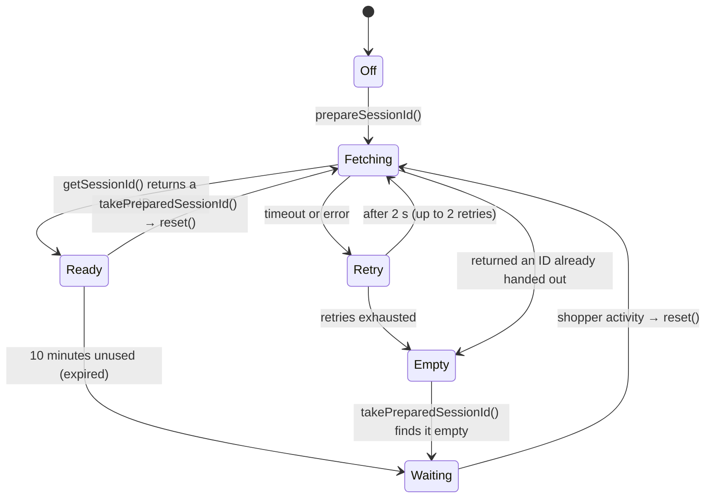

# Browser scripts

This reference describes each script under `assets/js/`: when it loads, what it hooks, and how it handles the session ID through the life of a payment attempt. The public part of `window.wcFraudProtection` is in the [API reference](../api-reference.md#browser-api); this page also covers the internal parts.

## Contents

- [Rules every script follows](#rules-every-script-follows)
- [Script handles and dependencies](#script-handles-and-dependencies)
- [blackbox-init.js](#blackbox-initjs)
- [blocks-checkout.js](#blocks-checkoutjs)
- [shortcode-checkout.js](#shortcode-checkoutjs)
- [pay-for-order.js and add-payment-method.js](#pay-for-orderjs-and-add-payment-methodjs)
- [stripe-add-payment-method.js](#stripe-add-payment-methodjs)
- [woopayments-add-payment-method.js](#woopayments-add-payment-methodjs)
- [express-checkout.js](#express-checkoutjs)
- [paypal-express.js](#paypal-expressjs)
- [kustom-blocks-checkout.js](#kustom-blocks-checkoutjs)
- [Missing session ID reasons](#missing-session-id-reasons)
- [Testing scripts](#testing-scripts)

## Rules every script follows

- **Fail open.** A script never stops a payment. It never rejects, never throws out of a handler, and sends the request without a session ID when it has none.
- **Take the session ID at submission.** `acquireSessionIdResult()` asks the SDK to send its latest data before it hands out the ID, so take the ID when the shopper submits, not ahead of time.
- **One session ID, one attempt.** An ID is never reused by a later attempt. When an attempt takes more than one request, such as Stripe's setup-intent request followed by the final form post on Add payment method, they all carry the same ID. After the attempt has used it, the script starts a fresh session with `reset()`, or uses a method that does it.
- **Reset only after use.** Resetting before the request is sent changes the session that the request is about to report.
- **Report why there's no ID.** Without an ID, the script sends the reason instead (see [Missing session ID reasons](#missing-session-id-reasons)).
- **Don't run gateway handlers twice.** Holding a submission and re-submitting it must not start a gateway's tokenization twice.
- **No build step.** Files in `assets/` are served as they are. Write plain ES2020 that browsers run directly.

## Script handles and dependencies

| Handle | File | Loaded by | Depends on |
|--------|------|-----------|------------|
| `wc-fraud-protection-blackbox` | `https://blackbox-api.wp.com/v1/dist/v.js` | `BlackboxScriptHandler` | none |
| `wc-fraud-protection-blackbox-init` | `blackbox-init.js` | `BlackboxScriptHandler` | `wc-fraud-protection-blackbox` |
| `wc-fraud-protection-blocks-checkout` | `blocks-checkout.js` | `BlocksCheckoutProtector`; `PayPalScriptCompat` on the Cart block | init, [`wp-data`](https://developer.wordpress.org/block-editor/reference-guides/packages/packages-data/), `wc-blocks-checkout-events` |
| `wc-fraud-protection-shortcode-checkout` | `shortcode-checkout.js` | `ShortcodeCheckoutProtector`; `KustomCompat` on Kustom's embedded checkout | init, `jquery` |
| `wc-fraud-protection-pay-for-order` | `pay-for-order.js` | `PayForOrderProtector`, `SubscriptionsChangePaymentCompat`, `request_pay_for_order_script()` | init, `jquery` |
| `wc-fraud-protection-add-payment-method` | `add-payment-method.js` | `AddPaymentMethodProtector` | init, `jquery` |
| `wc-fraud-protection-stripe-add-payment-method` | `stripe-add-payment-method.js` | `StripeSetupIntentCompat` | add-payment-method, `jquery` |
| `wc-fraud-protection-woopayments-add-payment-method` | `woopayments-add-payment-method.js` | `WooPaymentsSetupIntentCompat` | add-payment-method |
| `wc-fraud-protection-express-checkout` | `express-checkout.js` | `ExpressCheckoutScriptCompat` | init, [`wp-hooks`](https://developer.wordpress.org/block-editor/reference-guides/packages/packages-hooks/), `jquery` |
| `wc-fraud-protection-paypal-express` | `paypal-express.js` | `PayPalScriptCompat` | init |
| `wc-fraud-protection-kustom-blocks-checkout` | `kustom-blocks-checkout.js` | `KustomCompat` | init, `wp-data` |

`wc-fraud-protection-blackbox-init` and `wc-fraud-protection-pay-for-order` are public handles. The others may change.

The protectors and compatibility layers load the shared scripts with `BlackboxScriptHandler::request_scripts()`, which enqueues them on the payment surface it's called from. A gateway's own script uses `register_scripts_for()` instead: it registers the shared scripts without enqueuing them and makes the gateway's script depend on the init script, so WordPress prints them wherever that script is enqueued. On pages that must not load them, such as the order confirmation page or a post preview, a `print_scripts_array` filter leaves the shared scripts out, and the gateway's script runs without `window.wcFraudProtection`.

`BlackboxScriptHandler` localizes `window.wcFraudProtection.config` on the init script:

| Key | Value |
|-----|-------|
| `apiKey` | `woo:{Jetpack blog ID}` |
| `identityCookie` | Name, path and domain of the `wfp_id` cookie |
| `timeout` | 3000 ms |
| `sessionIdField` | `wc_fraud_protection_session_id` (public) |
| `sessionIdErrorField` | `wc_fraud_protection_session_id_error` |

## blackbox-init.js

Sets up `window.wcFraudProtection` on top of the `config` object.

On load:

1. If the SDK isn't on the page, it sets up only methods that hand out no session ID (`acquireSessionIdResult()` resolves to `sdk_unavailable`, `takeSessionId()` to `''`, `takePreparedSessionId()` returns `''`, and `addSessionIdToExtensions()` adds the reason) and stops. **`acquireSessionId()`, `reset()`, `handOverSessionId()` and `onPreparedSessionIdChange()` aren't defined at all** in that case, so check for each method before calling it.
2. Otherwise it reads the `wfp_id` identity cookie, or creates it with a random 32-character hexadecimal value. The server-side `SessionIdentityManager` uses the same cookie and format.
3. It calls `Blackbox.configure()` with the API key and identity, then `Blackbox.init()`, which starts collecting.

Methods:

| Method | Public | Behavior |
|--------|--------|----------|
| `acquireSessionIdResult()` | No | Calls `Blackbox.flush({ deadlineMs })`, resolves to `{ sessionId, error }`. Marks the ID as handed out. Never rejects. See [Handing out each ID once](#handing-out-each-id-once). |
| `acquireSessionId()` | Yes | `acquireSessionIdResult()` without the error. The caller must call `reset()` after the attempt. |
| `takeSessionId()` | Yes | `acquireSessionIdResult()`, then `reset()` when it got an ID. |
| `reset()` | Yes | Clears the prepared slot, calls `Blackbox.reset()` with a timeout, then prepares a new ID if preparation is on. |
| `prepareSessionId()` | Yes | Turns on preparation: keeps one session ID ready in a slot. |
| `takePreparedSessionId()` | Yes | Hands out the prepared ID once, then resets. Returns `''` when none is ready or it's older than 10 minutes. |
| `addSessionIdToExtensions( extensions )` | Yes | Returns a copy of Store API extension data with the prepared ID, or the reason, under `woocommerce/fraud-protection`. Replaces any ID already there. |
| `handOverSessionId( sessionId, condition? )` | No | Lets the next acquisition return `sessionId` once more, if `condition()` returns `true` then. A reset cancels it. |
| `onPreparedSessionIdChange( listener )` | No | Calls `listener` now and on each change of the prepared ID, without taking it. |

### Handing out each ID once

The SDK returns the same session ID until it's reset, and a flow can miss a `reset()`. So `acquireSessionIdResult()` never hands out an ID twice:

- `handedOutSessionIds` remembers every ID given to a request.
- When `flush()` returns an ID that was already handed out, the method starts a new session and flushes again within what's left of the same deadline. If no new ID arrives in time, it resolves to an empty ID with the `reused` reason.
- The exception is a **hand-over**. When a request's payment is completed by a later request of the same attempt that must send the same ID, the script that sent the first request passes its ID to `handOverSessionId()`. The next acquisition, and only that one, returns the ID again, if the optional condition still returns `true`; otherwise, or when the condition throws, it gets a new ID. `paypal-express.js` uses this for setup-token and vault-order requests.
- `onPreparedSessionIdChange()` is for flows that place the order without the browser, so the ID has to be stored before the shopper pays. The listener follows the prepared ID without taking it, so the session keeps collecting. `kustom-blocks-checkout.js` uses it.

### The prepared slot

Code that builds a request synchronously can't wait for `flush()`. The prepared slot keeps an ID ready:

Details that matter:

- Preparation uses the SDK's `getSessionId()`, not `flush()`: ahead of the payment attempt there's nothing new to send.
- The slot never accepts an ID in `handedOutSessionIds`, so it never prepares an ID that a request already used.
- An expired or empty slot waits for the shopper's next activity (pointer, key, touch, focus, blur, visibility change) before starting a new session. A page left open doesn't keep creating sessions. `window` `blur` is in the list because a click inside a cross-origin express-button iframe reaches the page only as a blur.
- A counter (`preparation`) discards results from a preparation that a later `reset()` replaced.

## blocks-checkout.js

Runs on pages with the Checkout block.

- **On submit:** registers an [`onCheckoutValidation`](https://developer.woocommerce.com/docs/block-development/extensible-blocks/cart-and-checkout-blocks/checkout-payment-methods/checkout-flow-and-events/#oncheckoutvalidation) callback. WooCommerce Blocks waits for its promise before sending the request. The callback acquires the session ID and calls `wp.data.dispatch( 'wc/store/checkout' ).setExtensionData( 'woocommerce/fraud-protection', { blackbox_session_id, blackbox_session_id_error? }, true )`.
- **After a failure:** [`onCheckoutFail`](https://developer.woocommerce.com/docs/block-development/extensible-blocks/cart-and-checkout-blocks/checkout-payment-methods/checkout-flow-and-events/#oncheckoutfail) calls `reset()`. The shopper stays on the page and the next attempt needs a new ID.
- **After success:** no reset. The page navigates to the order confirmation.
- **When the attempt stops in the browser:** a gateway can reject the card details after validation, before the request is sent. The checkout store goes back to idle without `onCheckoutFail`. A [`wp.data.subscribe()`](https://developer.wordpress.org/block-editor/reference-guides/packages/packages-data/#subscribe) watcher notices that an acquired ID was never sent and resets.

The Store API fills missing extension keys with `null`. The server uses that to tell "the script ran and had no ID" (an empty string) from "the script didn't run" (`null`).

## shortcode-checkout.js

Runs on the classic checkout. It's the most intricate script, because WooCommerce's `checkout.js` and gateway scripts all compete for the same submission.

### Normal path

1. `checkout_place_order` fires on `form.checkout`. If the session ID field is missing, the handler returns `false` to hold the submission and starts `acquireSessionIdResult()`.
2. When the ID arrives, it adds hidden fields (`wc_fraud_protection_session_id` and, without an ID, the reason) and triggers `submit` again.
3. `checkout_place_order` fires again. The field is there, so the handler returns `true` and WooCommerce sends the AJAX request.

### Why the field stays until the request completes

A gateway's own `checkout_place_order_{gateway}` handler can stop the submission, create a payment method in the browser, and submit the form again itself. The field must still be there for that second submission. So the script removes the fields only when the checkout request completes, in a `complete` callback it adds through `$.ajaxPrefilter`, and then calls `reset()` if a session ID was sent.

It uses the request's own callbacks rather than jQuery's global AJAX events, because a request sent with `global: false` doesn't fire those.

### When another handler lets the request go first

Another `checkout_place_order` handler can return `true` before this script's handler runs, so the request leaves without the field. The `$.ajaxPrefilter` hook catches it:

- it adds the prepared session ID from `takePreparedSessionId()` to the request body, or `not_ready` when none is ready;
- the ID that the held submission later acquires isn't used for this attempt, and stays in the form for the next one;
- the form isn't submitted again for the attempt that already left.

The script calls `prepareSessionId()` on load so that a prepared ID exists for this case.

Kustom's embedded checkout always takes this path: its iframe callback posts the form to the checkout endpoint without submitting it, so `checkout_place_order` never fires.

### After an error

`checkout_error` resets the attempt when no checkout request is in flight. Errors reported inside the request are handled by its `complete` callback, which knows what the request carried.

## pay-for-order.js and add-payment-method.js

The two scripts are the same apart from the form ID (`#order_review` and `#add_payment_method`). Both forms post normally and end in a page load, so neither resets the session.

1. A `submit` listener in the **capture phase** runs before jQuery and gateway handlers.
2. If the session ID field isn't there yet, it calls `preventDefault()` and `stopImmediatePropagation()`, so gateway handlers (such as Stripe's tokenization) don't start, and acquires the ID.
3. It adds the hidden fields, then, in a new task, dispatches a new `submit` event. Gateway handlers now run normally. If none of them cancels the event, it calls `form.submit()` for a plain form post.
4. While a re-submit is pending, further submits (double clicks) are cancelled.

The new task in step 3 is for Firefox, which ignores a `submit` event fired on a form while another `submit` event is being dispatched on it.

Without an ID, the empty field is removed right after the re-submit. A gateway that posts the form natively later still sends the reason field.

### Submits started with jQuery

`pay-for-order.js` also handles a submit that a gateway starts with jQuery's `trigger( 'submit' )`, as Square's Apple Pay, Google Pay and Cash App Pay buttons do. `trigger()` runs the jQuery handlers and then calls the form's native `submit()`, which fires no `submit` event, so the capture listener never sees it.

- The script calls `prepareSessionId()` on load, and adds a jQuery `submit` handler.
- A native submit can't reach that handler without the session ID field, because the capture listener holds it until the field is there. So when the handler runs without the field, the submit came from `trigger()`.
- jQuery handlers can't be held and run again, since gateway handlers may already have run. So the handler doesn't hold the submit: it adds the prepared session ID, or only the `not_ready` reason when none is ready, and lets it continue. Leaving the session ID field out lets a later native submit still acquire an ID.
- A jQuery submit that arrives while a held submit is pending is cancelled, and a missing `config` or any error leaves the form unchanged, so `trigger()` still posts it.

`add-payment-method.js` doesn't have this handler.

## stripe-add-payment-method.js

On Add payment method, Stripe sends `wc_stripe_create_and_confirm_setup_intent` through AJAX before the form post. This script, loaded only when a Stripe gateway is available and doesn't declare `fraud_protection_add_payment_method`:

- uses `$.ajaxPrefilter` to copy the form's session ID and reason fields into that request;
- when the request fails, or a later submit isn't Stripe's final form post (for example after a failed 3-D Secure challenge), removes the fields and resets, so the next attempt gets a new ID;
- after a successful setup, keeps the fields for the final form post, which then reuses the decision through `StripeSetupIntentCompat`.

## woopayments-add-payment-method.js

The WooPayments counterpart of `stripe-add-payment-method.js`. On Add payment method, WooPayments sends its `create_setup_intent` request with `fetch()` before the form post. This script, loaded only when the WooPayments card gateway is available and doesn't declare `fraud_protection_add_payment_method`:

- wraps `window.fetch` and copies the form's session ID and reason fields into the `FormData` body of that request; a field the request already has with the form's value counts as sent, and a different value is left alone;
- when the request fails, or a later submit isn't WooPayments' final form post (it has no `wcpay-setup-intent` field, for example after a failed card authentication), removes the fields and resets, so the next attempt gets a new ID;
- ends only the latest request's attempt, and removes only the fields that still hold the values it sent, so a request that fails after a newer one was sent (a double submit) leaves the newer attempt's fields;
- after a successful setup, keeps the fields for the final form post, which then reuses the decision through `WooPaymentsSetupIntentCompat`.

## express-checkout.js

Loaded where WooPayments, Stripe or Square enqueued their express button scripts, for the gateways that don't declare `fraud_protection_express_checkout`. `wcFraudProtectionExpressCheckout.gateways` lists them.

1. Calls `prepareSessionId()`.
2. For WooPayments and Stripe, adds a [`wp.hooks`](https://developer.wordpress.org/block-editor/reference-guides/packages/packages-hooks/) filter, under the `woocommerce/fraud-protection` namespace, to `wcpay.express-checkout.cart-place-order-extension-data` and `wcstripe.express-checkout.cart-place-order-extension-data`. The filter returns `addSessionIdToExtensions( extensionData )`.
3. For Square, adds a `$.ajaxPrefilter`. Square's wallet buttons post the order to `?wc-ajax=square_digital_wallet_process_checkout`, which runs the classic checkout process, and Square has no filter for that request. The prefilter appends the prepared session ID from `takePreparedSessionId()` to the request body, or `not_ready` when none is ready.

The extension-data filter always replaces an existing session ID: on the checkout page, the extension data can still hold the ID from an earlier checkout-form attempt. Square's request is built from the wallet's data, not from the checkout form, so it never holds an earlier ID.

## paypal-express.js

Wraps `window.fetch`. For requests to `?wc-ajax=ppc-create-order`, `ppc-create-setup-token` and `ppc-vault-create-order`:

1. If the previous protected request succeeded, it resets first, so this request gets a new session.
2. It acquires the session ID and adds it, or the reason, to the JSON body.
3. After the response, it resets on a failure. Otherwise it marks that the next protected request must reset first, and starts watching for another gateway.

Any other request goes to the original `fetch` untouched. Errors in the wrapper fall back to the original request.

A response is a confirmed success only when its JSON body has `"success": true`, which PayPal Payments sends for every success. A body with `"success": false`, or a failed response, is a failure. Any other readable body is unknown: it keeps the session like a success, but isn't treated as one below.

The rest of the script keeps each session ID to one attempt across PayPal's several requests:

- **Hand-over to the checkout.** The checkout that completes a setup-token or vault-order request reuses that request's decision only when it sends the same session ID. So after a confirmed success of one of those two requests, the script passes the ID it sent to `handOverSessionId()`, with a condition that checks that PayPal is still the selected gateway. The check runs when the checkout acquires its ID, because on the classic checkout that happens before the reset below. Create-order requests don't hand over: their records also match on the PayPal order ID.
- **Another gateway takes over.** After a request that kept its session, the script watches the gateway selection: `change` on `payment_method` and `checkout_place_order` on the classic checkout and Pay for order, and the active payment method in `wc/store/payment` on the Checkout block. When the shopper moves to a gateway whose ID doesn't start with `ppcp-`, for example after closing PayPal, it resets, so that payment gets a new session.
- **Card fields on the Checkout block.** PayPal's card fields send their request while the Checkout block is processing the order, after the block has acquired its session ID; for a free trial, that's the setup-token request. Such a request sends the session ID from the checkout's extension data instead of acquiring one, doesn't reset first, and doesn't hand its ID over.

## kustom-blocks-checkout.js

Loaded on the Checkout block when the Kustom gateway is available and doesn't declare `fraud_protection_express_checkout`. Kustom's servers place the order through the Store API after the shopper pays in its iframe, so the block's submit events never run. Kustom (2.24.1 or later) stores the block's extension data in the WooCommerce session and sends it with that request.

- The script calls `prepareSessionId()` and follows the prepared ID through `onPreparedSessionIdChange()`, without taking it, so the session keeps collecting until the order is placed.
- While Kustom (`kco`) is the selected payment method, it keeps the ID, or `not_ready` when none is ready, in the checkout's extension data under `woocommerce/fraud-protection`. It subscribes to `wc/store/payment`, because the shopper can select Kustom after the ID is ready.
- Another payment method overwrites the data when its own submit runs.

The browser isn't told when Kustom's servers use the ID, so it isn't reset after the attempt. `KustomCompat` makes sure the ID is verified only once (see [Compatibility layers](compatibility-layers.md#kustomcompat)).

## Missing session ID reasons

| Reason | Sent by | Meaning |
|--------|---------|---------|
| `timeout` | Browser | The SDK didn't answer in time. |
| `sdk_error` | Browser | The SDK failed or returned no session ID. |
| `sdk_unavailable` | Browser | The SDK script isn't on the page. |
| `not_ready` | Browser | The request left before an ID was ready. `KustomCompat` also sends it on, server-side, in place of an ID that an earlier Kustom attempt already sent. |
| `reused` | Browser | The SDK only had an ID that an earlier attempt already took, and no new one arrived in time. |
| `not_submitted` | Server | The request had neither a session ID field nor a reason, so the plugin's scripts didn't handle it. |
| `unknown` | Server | The reason field held an unrecognized value, or the session ID field was empty with no reason. |

`SessionIdError` reads the reason. It's internal: field names and values can change.

## Testing scripts

Each script has a Jest test under `tests/js/`, run with `npm run test:js`. The tests load the file into JSDOM with fake `Blackbox`, `jQuery` and `wp` objects. When you change a script, cover:

- the path with a session ID and the path without one, for each reason;
- a second attempt on the same page, checking that it gets a new ID;
- double submissions;
- what happens when another handler or gateway script submits first.

JSDOM doesn't reproduce browser quirks such as Firefox's nested `submit` handling. Check those in a real browser.
