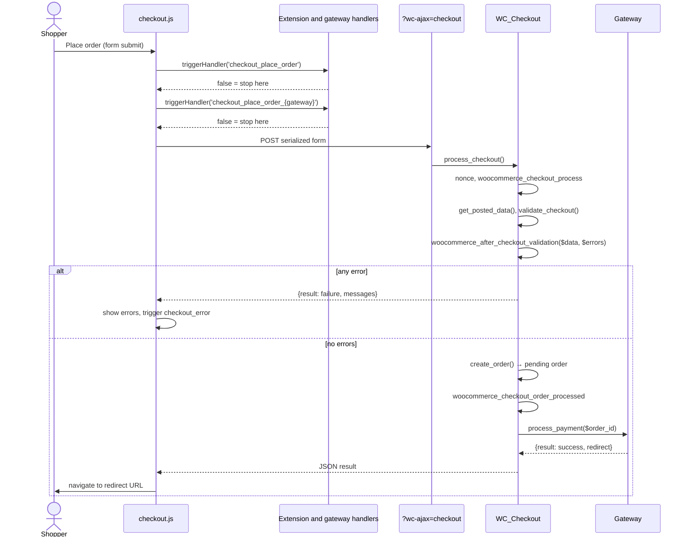
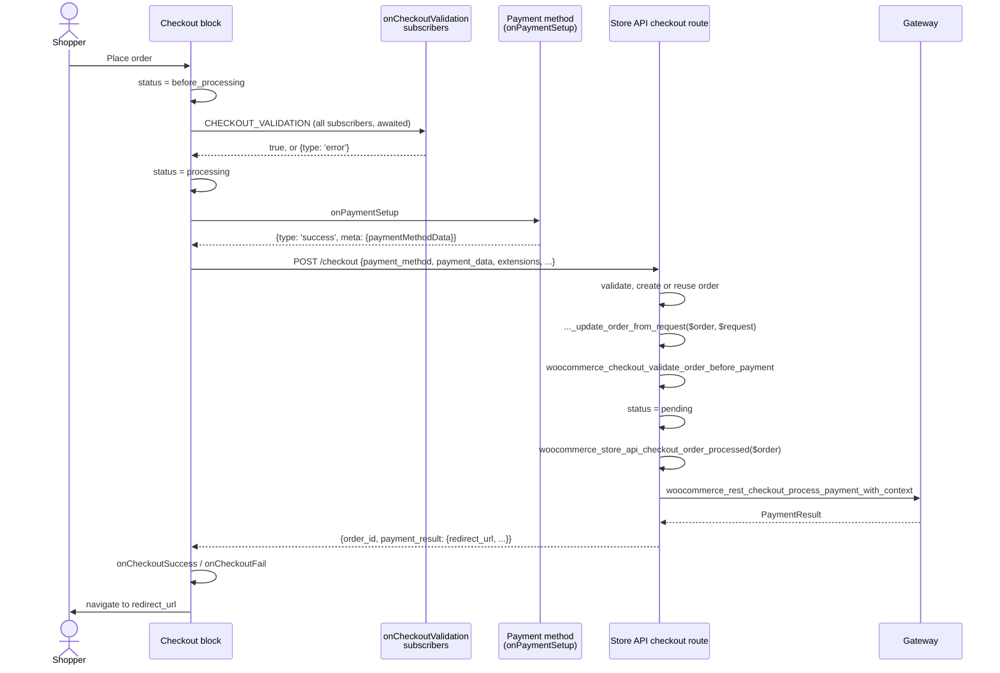

# 1. The WooCommerce checkout

This chapter explains what happens between a shopper clicking **Place order** and an order being paid. It covers both of WooCommerce's checkouts, the Pay for order and Add payment method flows, and the hooks an extension can use along the way. It assumes you know PHP and JavaScript, but not WooCommerce's internals.

The details match WooCommerce 11.3. Paths are relative to WooCommerce's plugin directory (`plugins/woocommerce/` in the [WooCommerce monorepo](https://github.com/woocommerce/woocommerce)). Read the source alongside this chapter: it's the only fully reliable reference.

## Contents

- [WordPress basics you'll need](#wordpress-basics-youll-need)
- [The main objects](#the-main-objects)
- [Two checkouts](#two-checkouts)
- [Sessions, carts and nonces](#sessions-carts-and-nonces)
- [The classic checkout, step by step](#the-classic-checkout-step-by-step)
- [The block checkout, step by step](#the-block-checkout-step-by-step)
- [Pay for order](#pay-for-order)
- [Add payment method and saved cards](#add-payment-method-and-saved-cards)
- [Express checkouts](#express-checkouts)
- [Orders after the checkout](#orders-after-the-checkout)
- [Where an extension can step in](#where-an-extension-can-step-in)
- [Gotchas](#gotchas)
- [Further reading](#further-reading)

## WordPress basics you'll need

WooCommerce is a WordPress plugin, and it's extended the WordPress way.

- **Hooks.** Code announces moments with `do_action( 'name', ...$args )` and lets others change values with `apply_filters( 'name', $value, ...$args )`. Other code attaches with `add_action()` and `add_filter()`. Callbacks run in **priority** order (default 10, lower first). The fourth argument, `accepted_args`, says how many arguments the callback receives.
- **Request lifecycle.** A front-end request loads plugins (`plugins_loaded`), initializes (`init`), parses the URL (`wp`), picks a template (`template_redirect`), renders, and ends (`shutdown`). Many WooCommerce form handlers run on `wp_loaded` or `wp`.
- **Scripts.** Plugins register browser scripts with `wp_enqueue_script( $handle, $url, $deps )`. WordPress prints them in dependency order. `wp_localize_script()` adds a JavaScript object with server data.
- **AJAX.** WooCommerce has its own lightweight endpoint: `/?wc-ajax={action}` fires the `wc_ajax_{action}` action.
- **REST API.** Routes under `/wp-json/`. WooCommerce's front end uses the **Store API**, under `/wp-json/wc/store/v1/`.
- **Nonces.** Short-lived tokens that protect forms against cross-site request forgery. They're not authentication.

## The main objects

| Object | Access | What it is |
|--------|--------|------------|
| Session | `WC()->session` | Server-side storage for one shopper, in the `{prefix}woocommerce_sessions` table, keyed by a cookie or token |
| Customer | `WC()->customer` | The shopper's addresses and details. Backed by the session for guests |
| Cart | `WC()->cart` | Items, coupons, shipping and totals. Stored in the session |
| Order | `wc_get_order( $id )` | A `WC_Order`: items, addresses, totals, status, payment method, meta. The record of a purchase |
| Payment gateway | `WC()->payment_gateways()` | A `WC_Payment_Gateway` subclass that takes payment. [Chapter 2](02-payment-gateways.md) covers them |
| Payment token | `WC_Payment_Tokens` | A saved payment method, such as a card a customer can reuse |

Two habits matter from the start:

- **Use the CRUD API for orders**: `$order->get_*()`, `$order->update_meta_data()`, `$order->save()`. Orders may live in custom tables (High-Performance Order Storage, HPOS), so `get_post_meta()` and direct queries against posts are wrong.
- **Expect any of these to be missing.** In the admin, in a cron job, in a REST request or on an early hook, `WC()->session` or `WC()->cart` can be `null`.

## Two checkouts

WooCommerce has two checkout implementations, and a store uses one or the other:

| | Classic checkout | Block checkout |
|--|------------------|----------------|
| Page content | `[woocommerce_checkout]` shortcode | `woocommerce/checkout` block |
| Rendering | PHP templates (`templates/checkout/form-checkout.php`) | React app (`client/blocks/`) |
| Browser script | `client/legacy/js/frontend/checkout.js` (jQuery) | WooCommerce Blocks, `@wordpress/data` stores |
| Submission | AJAX `POST /?wc-ajax=checkout` (form-encoded) | REST `POST /wp-json/wc/store/v1/checkout` (JSON) |
| Server entry point | `WC_Checkout::process_checkout()` | `StoreApi\Routes\V1\Checkout::process_order()` |
| Order created | After validation, before payment | At the POST, reused on retries |

- The checkout page is the page set in WooCommerce > Settings > Advanced. What it contains decides which checkout runs.
- New stores get the block checkout. Many existing stores, and many themes and checkout plugins, use the classic one. Fraud Protection must protect both.
- The cart has the same split: the `[woocommerce_cart]` shortcode with `WC_AJAX` and `WC_Form_Handler`, or the `woocommerce/cart` block with the Store API.

The two checkouts share almost no hooks. Code that hooks only one of them leaves the other unprotected.

## Sessions, carts and nonces

- **The session cookie.** `WC_Session_Handler` stores a guest's data under a random customer ID (`t_` and 30 characters) and sets the `wp_woocommerce_session_{hash}` cookie the first time it's needed. Logged-in users are keyed by user ID. Guest sessions last two days, logged-in sessions seven. The session is written to the database at `shutdown`.
- **Store API cart tokens.** A Store API request can carry a `Cart-Token` header (a signed JWT) instead of the cookie. WooCommerce then switches to a cookie-less session handler, `src/StoreApi/SessionHandler.php`. Headless storefronts and some express flows use this.
- **Store API nonces.** Write requests need a `Nonce` header for the `wc_store_api` action, unless they carry a valid `Cart-Token`. Every Store API response hands out a fresh nonce, and for guests the nonce isn't tied to the session. It stops cross-site request forgery, but it doesn't stop a bot.
- **Classic nonces.** `woocommerce-process_checkout`, `woocommerce-pay` and `woocommerce-add-payment-method` are tied to the guest's session.
- **Session keys used by the checkout**: `order_awaiting_payment` (the order being paid), `store_api_draft_order` (the block checkout's order), `chosen_payment_method`, `chosen_shipping_methods`.

## The classic checkout, step by step

### Rendering

`WC_Shortcode_Checkout::checkout()` renders `templates/checkout/form-checkout.php`:

- a `<form class="checkout">` with the billing and shipping fields from `WC_Checkout::get_checkout_fields()`;
- the payment box (`templates/checkout/payment.php`): one radio button per available gateway, named `payment_method`, followed by the gateway's `payment_fields()` output;
- the **Place order** button, `#place_order`;
- the nonce field `woocommerce-process-checkout-nonce`.

The template fires actions such as `woocommerce_checkout_before_order_review` and `woocommerce_checkout_order_review`. Custom checkout templates don't always fire all of them, so an extension that needs to load something should pick a hook that every checkout render passes through.

### Live updates

While the shopper fills in the form, `checkout.js` posts the form to `?wc-ajax=update_order_review`. The server fires `woocommerce_checkout_update_order_review`, recalculates shipping and totals, and returns HTML fragments. The browser **replaces the whole payment box** with the new HTML and triggers `updated_checkout`. Anything an extension added inside the payment box is gone after each update.

### Placing the order

**In the browser** (`checkout.js`, `wc_checkout_form.submit()`):

1. If the form has the `processing` class, the click is ignored.
2. `checkout_place_order` runs on `form.checkout`. If any handler's result is `false`, the submission stops.
3. `checkout_place_order_{gateway_id}` runs for the selected gateway. Gateways that tokenize the card in the browser return `false` here, do their async work, and submit the form again.
4. The form is posted to `?wc-ajax=checkout`.
5. On success, `checkout_place_order_success` runs, then the browser goes to `result.redirect`. On failure, the messages are shown and `checkout_error` fires on `document.body`.

These are jQuery `triggerHandler()` events. The result is the **last** handler's non-`undefined` return value, so a handler bound later that returns `true` can override an earlier `false`. Handlers can also run twice per click, when a gateway re-submits the form.

**On the server** (`WC_Checkout::process_checkout()`):

1. Verify the nonce.
2. `woocommerce_before_checkout_process`, then `woocommerce_checkout_process`: early validation. Add an error notice or throw to stop.
3. `get_posted_data()` reads only the declared checkout fields and a few fixed keys. **Gateway fields stay in `$_POST`.**
4. `update_session()` saves the addresses and chosen methods.
5. `validate_checkout()` checks required fields, the cart, terms, shipping, and the gateway's own `validate_fields()`, then fires **`woocommerce_after_checkout_validation( $data, $errors )`**. Adding to the `WP_Error` stops the checkout.
6. Each error becomes a notice. If there are any, the request ends with `{ result: failure, messages }` and **no order is created**.
7. `create_order()`:
    - reuses the order in `order_awaiting_payment` when it's `pending` or `failed` and the cart hasn't changed (`woocommerce_resume_order`), or creates a new one;
    - fires `woocommerce_checkout_create_order( $order, $data )` before the first save;
    - saves the order with status `pending`;
    - fires `woocommerce_checkout_update_order_meta` and `woocommerce_checkout_order_created`, where WooCommerce reserves stock.
8. `woocommerce_checkout_order_processed( $order_id, $posted_data, $order )`: the order exists and hasn't been paid.
9. If the order needs payment, `process_order_payment()` saves `order_awaiting_payment` in the session and calls the gateway's **`process_payment( $order_id )`**. Otherwise `payment_complete()` runs directly.
10. A `success` result goes through `woocommerce_payment_successful_result` and is returned as JSON. Anything else returns the error notices.

The **thank-you page** (`/checkout/order-received/{id}/?key=...`) validates the order key, empties the cart, and fires `woocommerce_thankyou`. That hook fires on every view of the page, so it isn't an "order placed" event.

## The block checkout, step by step

### The pieces

The Checkout block is a React app built on `@wordpress/data` stores:

| Store | Holds |
|-------|-------|
| `wc/store/checkout` | Status (`idle`, `before_processing`, `processing`, `after_processing`, `complete`), order ID, extension data |
| `wc/store/payment` | Active payment method, payment data, status |
| `wc/store/cart` | Cart contents, addresses, totals |

Gateways register their UI with `registerPaymentMethod()` (and `registerExpressPaymentMethod()` for express buttons) from `wc.wcBlocksRegistry`, and a matching `AbstractPaymentMethodType` on the server.

While the shopper edits the form, the block sends `PUT /wc/store/v1/checkout` and `/cart/update-customer` requests. Since WooCommerce 10.8, these **don't create an order**: they save the data in the session. The order is created when the shopper places it.

### Placing the order

**In the browser:**

1. **Validation.** Every `onCheckoutValidation` subscriber runs, and the block waits for their promises. To stop the checkout, a callback returns `{ type: 'error', errorMessage }`. **A callback that throws doesn't stop it**: the error is only logged.
2. **Payment setup.** The active payment method's `onPaymentSetup` observers run. A gateway creates its payment method here (for example, tokenizing the card with its own SDK) and returns `{ type: 'success', meta: { paymentMethodData } }`. The last successful response replaces the payment data.
3. **The request.** `POST /wc/store/v1/checkout` with addresses, `payment_method` (the gateway ID), `payment_data` (the payment data flattened into `[ { key, value } ]` pairs), `extensions` (data that extensions set with `setExtensionData( namespace, data )`), and `expected_total`.
4. **The response.** On success, `onCheckoutSuccess` runs and the browser goes to `payment_result.redirect_url`. On an error, `onCheckoutFail` runs and the shopper stays on the page.

**On the server** (`Checkout::process_order()`):

1. Validate the request, the customer's right to order, the cart, and the totals. If the total grew past `expected_total`, the request fails with HTTP 409.
2. `woocommerce_store_api_checkout_update_customer_from_request( $customer, $request )`.
3. Create the order from the cart (status `checkout-draft`, `woocommerce_store_api_checkout_order_created`), or reuse the session's order when it still matches the cart. The ID goes in the `store_api_draft_order` session key.
4. **`woocommerce_store_api_checkout_update_order_from_request( $order, $request )`**: the only hook that receives the full request, including `extensions`.
5. `woocommerce_checkout_validate_order_before_payment( $order, $errors )`: the Store API counterpart of `woocommerce_after_checkout_validation`. Errors become HTTP 400.
6. Hold coupons and reserve stock.
7. Set the order to **`pending`**.
8. **`woocommerce_store_api_checkout_order_processed( $order )`**: the last hook before payment. Throwing a `RouteException` here stops the checkout; the order stays `pending`.
9. If the order needs payment, process it (below). Otherwise call `payment_complete()`.
10. Return the order and `payment_result`. The HTTP status follows the payment status: 200 for success, 202 for pending, 400 for failure, 500 for error.

### How the Store API pays

`CheckoutTrait::process_payment()` builds a `PaymentContext` (gateway ID, order, payment data as strings) and fires `woocommerce_rest_checkout_process_payment_with_context( $context, &$result )`.

- **Block-aware gateways** handle this action themselves and set the result's status (`success`, `failure`, `pending` or `error`) and redirect URL.
- **Other gateways** are handled by WooCommerce's legacy bridge (`src/StoreApi/Legacy.php`, priority 999). It **replaces `$_POST` with the payment data**, calls the gateway's `validate_fields()` and `process_payment()`, then restores `$_POST`. That's why a classic gateway works in the block checkout as long as its block UI sends the same field names.

### Errors in the Store API

- Throw `RouteException( $code, $message, $status )` from a Store API hook to return a clean error. A plain `\Exception` becomes HTTP 500 with the exception's message.
- `wc_add_notice()` errors are only converted to errors in a few places (add to cart, cart checks, the legacy payment bridge). Elsewhere, a notice is silently ignored.
- If something throws **after** the gateway has taken payment, WooCommerce reports success, because the money has moved.

### Paying an existing order through the Store API

`POST /wc/store/v1/checkout/{order_id}` pays an existing order. It fires the same hooks from `update_order_from_request` onward, including `woocommerce_store_api_checkout_order_processed`. No WooCommerce screen uses it, but headless storefronts and some gateways do.

## Pay for order

A `pending` or `failed` order can be paid later through its payment link: `/checkout/order-pay/{id}/?pay_for_order=true&key={order key}`. Shoppers get there after a failed payment, from an invoice email, or from My Account. Merchants create such orders by hand, too.

- **Rendering.** `WC_Shortcode_Checkout::order_pay()` checks the order key and the user's permission, fires `before_woocommerce_pay_form`, and renders `templates/checkout/form-pay.php`: a classic `<form id="order_review">` with the gateways, the `woocommerce-pay-nonce` field, and a hidden `woocommerce_pay` field. **This page is always the classic form**, even when the checkout page uses the block.
- **Submission.** The form posts normally, without AJAX. `checkout_place_order` doesn't fire here; gateways handle the form's `submit` event themselves.
- **Processing** (`WC_Form_Handler::pay_action()`, on `wp`):
    1. verify the nonce (a failure returns silently);
    2. load the order and check its key and `needs_payment()`;
    3. fire **`woocommerce_before_pay_action( $order )`**;
    4. check the terms, set the payment method, call `validate_fields()`;
    5. if there are no error notices, call `process_payment()` and redirect on success;
    6. otherwise, re-render the page with the errors.

To stop a payment here, add an **error notice** in `woocommerce_before_pay_action`. Don't throw: that hook runs outside the handler's `try` block, so an exception there is a fatal error.

## Add payment method and saved cards

### The Add payment method page

Logged-in customers can save a card at My Account > Payment methods > Add payment method (`/my-account/add-payment-method/`).

- The form is `<form id="add_payment_method">`, listing the gateways that support `add_payment_method` or `tokenization`. It fires `woocommerce_add_payment_method_form_bottom`.
- `WC_Form_Handler::add_payment_method_action()` handles the post:
    1. verify the nonce;
    2. apply the **`woocommerce_add_payment_method_form_is_valid`** filter: returning `false` stops it (silently, so add your own notice);
    3. rate-limit the user (one attempt every 20 seconds by default);
    4. call `validate_fields()`, then the gateway's **`add_payment_method()`**, and redirect.

`is_add_payment_method_page()` returns `true` on the Payment methods **list** page too. To detect the form itself, also check for the `add-payment-method` query variable.

### Saved cards at checkout

A saved card is a `WC_Payment_Token_CC` with the card type, last four digits and expiry. At checkout:

- the classic form shows radio buttons named `wc-{gateway_id}-payment-token`, whose value is the token ID or `new`, and a `wc-{gateway_id}-new-payment-method` checkbox to save a new card;
- the block checkout sends the same keys in `payment_data`, plus a bare `token` key.

An extension can read the token ID from those fields and load the card details with `WC_Payment_Tokens::get()`, after checking that the token belongs to the current user and the selected gateway.

## Express checkouts

Express checkouts are wallet buttons (Apple Pay, Google Pay, PayPal, Link) on product, cart and checkout pages. The shopper skips the form: the wallet supplies the address and payment method.

- In the block checkout, express methods are registered with `registerExpressPaymentMethod()`. When the wallet sheet completes, they run the same pipeline as the **Place order** button, and the request goes to `POST /wc/store/v1/checkout`. The block's own validation step is skipped for them.
- On product and cart pages, and in classic themes, each gateway does it its own way: its own `wc-ajax` endpoints, or Store API requests built by its own script.

Either way, the checkout form's browser events may never fire. [Chapter 2](02-payment-gateways.md#express-checkouts) covers the gateways' implementations.

## Orders after the checkout

### Statuses

| Status | Meaning |
|--------|---------|
| `checkout-draft` | Created by the block checkout, not yet placed. Deleted after a day if abandoned. |
| `pending` | Placed, awaiting payment |
| `failed` | Payment failed or was declined |
| `on-hold` | Awaiting action, such as a bank transfer or a manual review |
| `processing` | Paid, being fulfilled |
| `completed` | Fulfilled |
| `cancelled` | Cancelled; unpaid orders are cancelled automatically after the hold-stock time |
| `refunded` | Fully refunded |

- `$order->needs_payment()` is true for `pending` and `failed` orders (and `checkout-draft`) with a total above zero.
- `$order->payment_complete( $transaction_id )` marks an order as paid: it sets `processing` (or `completed` for orders that need no shipping), and fires `woocommerce_payment_complete`. Gateways call it, often from a webhook rather than the shopper's request.
- Status changes fire `woocommerce_order_status_changed` and `woocommerce_order_status_{from}_to_{to}`.

### Retries

A failed payment leaves a payable order. When the shopper tries again with the same cart in the same session, both checkouts **reuse that order**. So one order can see several payment attempts, and state tied only to the order ID would span them. With a different cart, a new order is created and the old one is eventually cancelled.

## Where an extension can step in

The hooks most useful to a fraud or risk extension, and whether they can stop the flow.

### Classic checkout

| Hook | When | Can stop it? |
|------|------|--------------|
| `checkout_place_order` (JavaScript) | Before the AJAX request | Return `false` (a later handler can override it) |
| `woocommerce_checkout_process` | Start of validation | Error notice or throw |
| `woocommerce_after_checkout_validation` | End of validation, before the order exists | `$errors->add()` |
| `woocommerce_checkout_create_order` | Before the first order save | Throw; the order isn't saved |
| `woocommerce_checkout_order_created` | After the order is saved | Throw; the `pending` order remains |
| `woocommerce_checkout_order_processed` | After the order is saved, before payment | Throw; the `pending` order remains |
| `woocommerce_payment_successful_result` | After the gateway succeeds | No: the payment has happened |

### Block checkout

| Hook | When | Can stop it? |
|------|------|--------------|
| `onCheckoutValidation` (JavaScript) | Before the request | Return `{ type: 'error' }`; throwing doesn't stop it |
| `setExtensionData()` (JavaScript) | Before the request | No: attaches data to `extensions` |
| `woocommerce_store_api_checkout_update_order_from_request` | Request applied to the order | Throw `RouteException` |
| `woocommerce_checkout_validate_order_before_payment` | Validation before payment | `$errors->add()` → HTTP 400 |
| `woocommerce_store_api_checkout_order_processed` | Order `pending`, before payment | Throw `RouteException` |
| `woocommerce_rest_checkout_process_payment_with_context` | Payment | Set a failed status, or throw |

To send your own data with the block checkout, register an `extensions` schema with `woocommerce_store_api_register_endpoint_data()` for the `checkout` endpoint, set the data with `setExtensionData()`, and read it from `$request['extensions'][ $namespace ]` in `woocommerce_store_api_checkout_update_order_from_request`.

### Pay for order and Add payment method

| Hook | When | Can stop it? |
|------|------|--------------|
| `before_woocommerce_pay_form` | Pay for order renders | No: load scripts here |
| `woocommerce_before_pay_action` | Pay for order submitted, before the gateway | Error notice (don't throw) |
| `woocommerce_add_payment_method_form_bottom` | Add payment method renders | No: load scripts here |
| `woocommerce_add_payment_method_form_is_valid` | Add payment method submitted, before the gateway | Return `false` and add a notice |

### After payment

| Hook | When |
|------|------|
| `woocommerce_payment_complete` | The order was marked as paid, possibly in a webhook request |
| `woocommerce_order_status_changed` | Any status change |

## Gotchas

1. **The classic checkout saves the order before payment.** Stopping after `create_order()` leaves a `pending` order with stock reserved. To stop without creating an order, use `woocommerce_after_checkout_validation`.
2. **The block checkout's order exists before payment, and is reused.** Retries with the same cart reuse it, so don't key per-attempt state on the order ID alone.
3. **Failed payments leave payable orders.** They can be paid later through Pay for order or the Store API. A check that only covers the checkout leaves that path open.
4. **The two checkouts' hooks don't overlap.** Implement both.
5. **jQuery event results can be overridden.** A later `checkout_place_order` handler can turn your `false` into `true`, and a gateway can submit the form again.
6. **The classic payment box is re-rendered on every update.** Put fields elsewhere in the form, or re-add them on `updated_checkout`.
7. **Notices and exceptions behave differently per flow.** Classic converts both to notices. The Store API needs `RouteException`. Pay for order needs a notice.
8. **Throwing in `onCheckoutValidation` doesn't stop the block checkout.** Return an error object.
9. **The Store API legacy bridge swaps `$_POST`.** During `process_payment()`, `$_POST` holds only the payment data, as strings.
10. **`is_checkout()` is true on the Pay for order and order-received pages**, and on any request that defines `WOOCOMMERCE_CHECKOUT`. `is_checkout_pay_page()` can trust a client-controlled query parameter.
11. **`is_add_payment_method_page()` is true on the payment methods list.**
12. **Pay for order is always the classic form**, with a plain form post, even on stores that use the block checkout.
13. **`woocommerce_thankyou` fires on every page view.** It's not an "order placed" event.
14. **"Order placed" isn't "order paid".** Redirect and asynchronous gateways mark the order paid in a later request, often a webhook without the shopper's session.
15. **Store API nonces don't identify a shopper.** Any client can get one.

## Further reading

- [Checkout flow and events](https://developer.woocommerce.com/docs/block-development/extensible-blocks/cart-and-checkout-blocks/checkout-payment-methods/checkout-flow-and-events/)
- [How the checkout block processes an order](https://developer.woocommerce.com/docs/block-development/extensible-blocks/cart-and-checkout-blocks/how-checkout-processes-an-order/) (older than WooCommerce 10.8's change to draft orders)
- [Store API: Checkout](https://developer.woocommerce.com/docs/apis/store-api/resources-endpoints/checkout/) and [Checkout order](https://developer.woocommerce.com/docs/apis/store-api/resources-endpoints/checkout-order/)
- [Store API: Nonce tokens](https://developer.woocommerce.com/docs/apis/store-api/nonce-tokens/) and [Cart tokens](https://developer.woocommerce.com/docs/apis/store-api/cart-tokens/)
- [Extending the Store API: exposing your data](https://developer.woocommerce.com/docs/apis/store-api/extending-store-api/extend-store-api-add-data/)
- [Checkout utilities](https://developer.woocommerce.com/docs/block-development/extensible-blocks/cart-and-checkout-blocks/checkout-utilities/)
- [High-Performance Order Storage](https://developer.woocommerce.com/docs/features/high-performance-order-storage/)

## Next

[Chapter 2](02-payment-gateways.md) looks at the gateways that `process_payment()` hands the order to.
