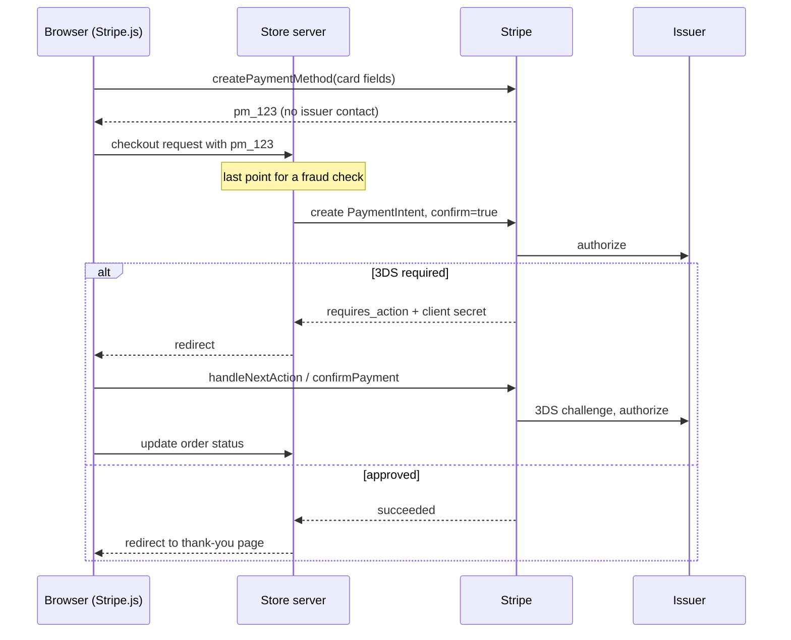
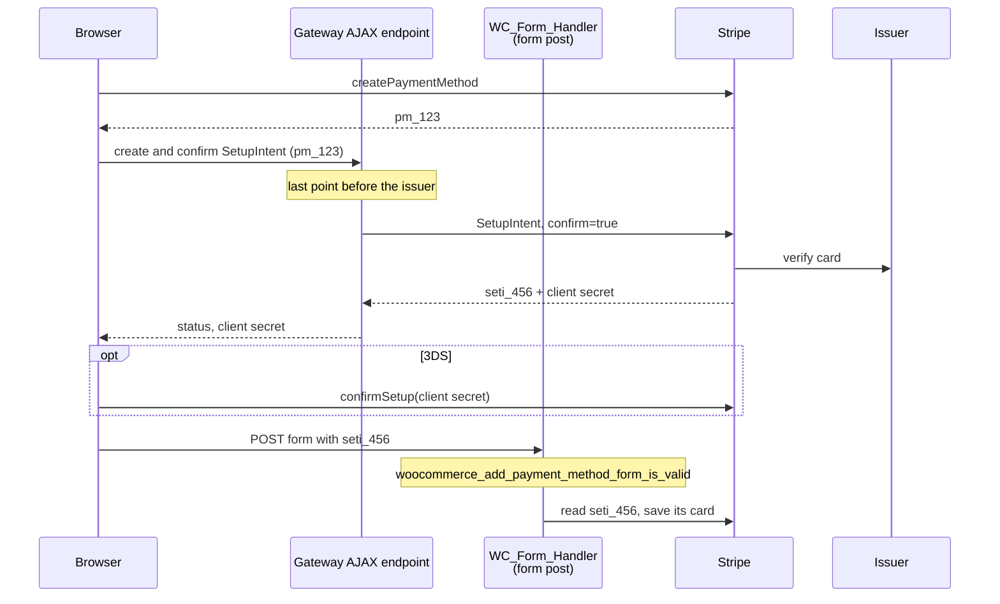
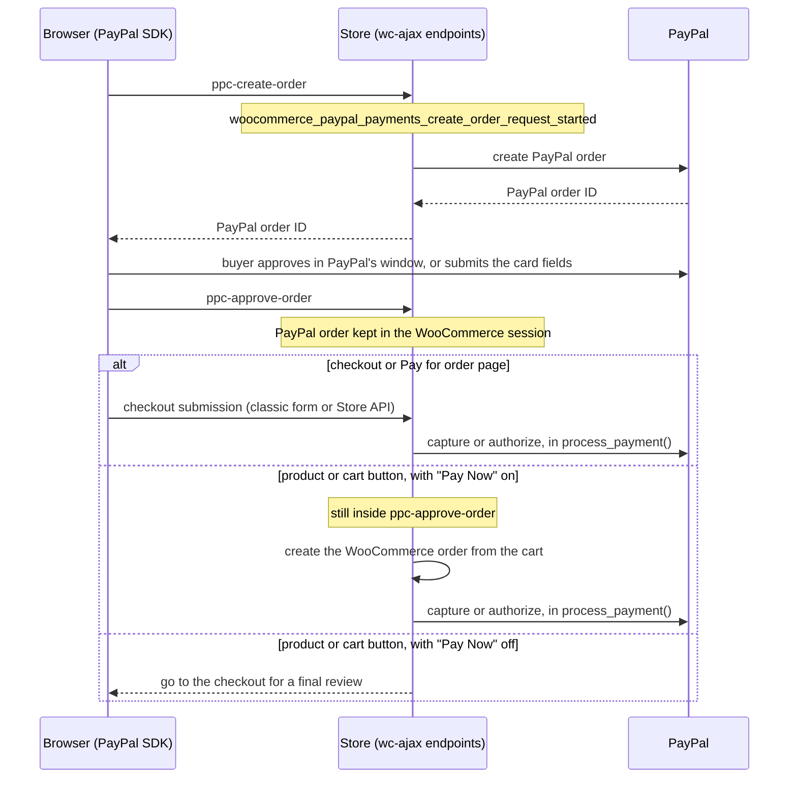

# 2. Payment gateways

[Chapter 1](01-woocommerce-checkout.md) ended with WooCommerce calling a gateway's `process_payment()`. This chapter looks at the gateways: how they plug into WooCommerce, how card payments work, and how Stripe, WooPayments, PayPal and Square actually take a payment. WooCommerce's own developer documentation covers the gateway API in depth, so this chapter keeps that part short and links to it. It spends more time on what matters for fraud protection: **when, and from where, the card reaches the bank.**

The gateway details match WooCommerce Stripe Gateway 10.1 and WooPayments 10.2. Gateways change often, so check their current source before relying on a detail.

## Contents

- [What a gateway is](#what-a-gateway-is)
- [How card payments work](#how-card-payments-work)
- [Intents](#intents)
- [Stripe and WooPayments flows](#stripe-and-woopayments-flows)
- [Express checkouts](#express-checkouts)
- [PayPal Payments](#paypal-payments)
- [Square](#square)
- [Saved payment methods](#saved-payment-methods)
- [WooCommerce Subscriptions](#woocommerce-subscriptions)
- [Where a fraud check can sit](#where-a-fraud-check-can-sit)
- [Further reading](#further-reading)

## What a gateway is

### The class

A gateway is a subclass of `WC_Payment_Gateway` (`includes/abstracts/abstract-wc-payment-gateway.php`), registered through the `woocommerce_payment_gateways` filter. The members that matter:

| Member | Purpose |
|--------|---------|
| `$id` | The gateway ID: posted as `payment_method`, stored on the order, used in field and hook names. For example `stripe`, `woocommerce_payments`, `ppcp-gateway`, `square_credit_card`. |
| `$supports` | Feature strings, such as `products`, `refunds`, `tokenization`, `add_payment_method`, `subscriptions`. It's an open list: Fraud Protection adds its own `fraud_protection_*` features. |
| `is_available()` | Whether the gateway can be used for this request (enabled, currency, amount, country). |
| `payment_fields()` | The HTML under the gateway's radio button on classic forms. |
| `validate_fields()` | Validation before payment. Adds error notices to stop. |
| `process_payment( $order_id )` | Takes the payment for an existing order. |
| `add_payment_method()` | Saves a payment method from My Account. |
| `process_refund()` | Refunds through the provider. |

`WC()->payment_gateways()->get_available_payment_gateways()` returns the gateways that are available **for the current request**. Every entry point looks the posted `payment_method` up in it, so an unavailable gateway can't be charged. Some plugins register **one gateway per payment method**: Stripe has `stripe`, `stripe_sepa`, `stripe_ideal` and more; WooPayments has `woocommerce_payments_*`; PayPal has `ppcp-*`.

### What `process_payment()` returns

On success: `[ 'result' => 'success', 'redirect' => $url ]`. On failure, the gateway adds an error notice and returns anything else, or throws. In practice:

- the `redirect` isn't always a page: Stripe returns fragments such as `#wc-stripe-confirm-pi:{order}:{client_secret}:{nonce}`, which its script picks up to finish 3-D Secure in the browser;
- the order may stay `pending` when the result is "success", until a later request or webhook confirms the payment;
- in the block checkout, WooCommerce's legacy bridge turns the array into a `PaymentResult`.

### The block checkout side

For the block checkout, a gateway also provides:

- a PHP class extending `AbstractPaymentMethodType`, registered on `woocommerce_blocks_payment_method_type_registration`, which declares the gateway's scripts and settings;
- a JavaScript `registerPaymentMethod()` call with the React component for its fields, `canMakePayment()`, and an `onPaymentSetup` handler. That handler typically sends the card to the provider's script and returns the resulting ID as `paymentMethodData`, which reaches the server as `payment_data`.

[Payment method integration for the checkout block](https://developer.woocommerce.com/docs/block-development/extensible-blocks/cart-and-checkout-blocks/checkout-payment-methods/payment-method-integration/) is the official guide.

### Where gateways run

| Flow | Gateway code called | Hook just before it |
|------|---------------------|---------------------|
| Classic checkout | `process_payment()` | `woocommerce_checkout_order_processed` |
| Block checkout and express buttons | `process_payment()` through the Store API | `woocommerce_store_api_checkout_order_processed` |
| Pay for order | `process_payment()` | `woocommerce_before_pay_action` |
| Add payment method | `add_payment_method()` | `woocommerce_add_payment_method_form_is_valid` |
| Gateway AJAX or REST endpoints | Gateway-specific | Gateway-specific |
| Webhooks | Gateway-specific | None: no shopper session |
| Subscription renewals | `woocommerce_scheduled_subscription_payment_{id}` | None: no browser |

The last three rows are where most of the subtlety lives.

## How card payments work

### The parties

| Party | Role |
|-------|------|
| Cardholder | The shopper. |
| Merchant | The store. |
| Provider (processor) | Stripe, PayPal, Square. Connects the merchant to the card networks and offers the APIs. WooPayments is built on Stripe Connect: each merchant has a Stripe account, and WooPayments' servers sit between the store and Stripe. |
| Acquirer | The bank that accepts card payments for the merchant, usually through the provider. |
| Card network | Visa, Mastercard and others. Routes requests between acquirer and issuer. |
| Issuer | The cardholder's bank. Approves or declines, and runs 3-D Secure. |

### The life of an online card payment

1. **Collection.** The card number goes from the shopper's browser straight to the provider, which returns a reference such as Stripe's `pm_...`. **The issuer isn't involved.**
2. **Authentication** (sometimes). The issuer checks that the shopper is the cardholder with 3-D Secure: invisibly, or with a challenge in the bank's app.
3. **Authorization.** The request travels acquirer → network → issuer. The issuer approves and holds the funds, or declines. **This step tells a fraudster whether a stolen card works.**
4. **Capture.** The merchant collects the authorized money, right away or later. An authorization that's never captured is released (voided).
5. **Settlement.** The money reaches the merchant's balance.
6. **Refund** (merchant-initiated) or **dispute** (cardholder-initiated, also called chargeback), possibly weeks later.

**Saving a card also reaches the issuer.** When a provider saves a card for later, it usually verifies it with the issuer (a zero or small authorization that's reversed). Fraudsters use card saves just like payments.

### Why the store never sees card numbers

Any system that touches card numbers falls under PCI DSS, the card industry's security standard, which is expensive to comply with. So modern gateways keep the card out of the store:

- **Hosted fields.** The card inputs are iframes served by the provider. The store's scripts can't read them; they can only ask the provider's script to tokenize the card.
- **Redirects and popups.** The shopper enters the card on the provider's site (PayPal).
- **Wallets.** Apple Pay and Google Pay produce a token that the provider turns into a payment method.

What the store can know about a card comes from the provider: brand, last four digits, expiry, funding (credit, debit, prepaid), country, and a **fingerprint** that's the same for the same card number across tokens. Some gateways post these fields from the browser; others need an API call to the provider.

### 3-D Secure and SCA

- **3-D Secure (3DS)** is the protocol that lets the issuer authenticate the cardholder.
- **Strong Customer Authentication (SCA)** is the European rule that requires it for most customer-initiated online payments.
- **Liability shift**: when 3DS succeeds, fraud chargebacks become the issuer's problem rather than the merchant's.
- **Customer-initiated vs merchant-initiated**: a payment with the shopper present can be challenged; a subscription renewal can't. Cards saved for future use are authenticated up front for that reason.

### Why the check must come first

Card testers run lists of stolen cards through stores' checkout and card-save forms, looking for approvals. Every authorization costs the merchant fees, raises its decline rate, and can turn into a chargeback. After authorization, "blocking" means voiding or refunding, and the tester already has the answer.

So the rule for any fraud check is: **decide before the first request that can make the provider contact the issuer.** The rest of this chapter is about finding that request.

## Intents

Stripe models each payment as an **intent**, a state machine on Stripe's side. WooPayments uses the same objects. The vocabulary shows up everywhere in the plugin.

### Objects

| Object | Prefix | Purpose |
|--------|--------|---------|
| PaymentMethod | `pm_` | A tokenized card or other instrument. Created in the browser by Stripe.js. Creating it doesn't contact the issuer. |
| Customer | `cus_` | Holds saved payment methods. |
| PaymentIntent | `pi_` | One attempt to collect an amount: authentication, authorization, capture. |
| SetupIntent | `seti_` | Saves a payment method for later without charging it: authenticates it and verifies it with the issuer. |
| ConfirmationToken | `ctoken_` | A newer alternative to a PaymentMethod for confirming on the server. |
| Charge | `ch_`, `py_` | The authorization or capture result. |
| Dispute | `dp_`, `du_` | A chargeback. |

A PaymentIntent moves through `requires_payment_method` → `requires_confirmation` → `requires_action` (3DS) → `processing` → `requires_capture` (authorized, not collected) → `succeeded`, or `canceled`. A declined authorization goes back to `requires_payment_method`. SetupIntents have the same statuses except `requires_capture`.

### Confirmation, and who does it

**Confirming** an intent is what sends it to the network. It can happen in two places:

- **On the server.** The browser creates a PaymentMethod and posts its ID. The server creates the intent with `confirm=true`. The issuer is contacted **during that server request**. If 3DS is needed, the intent comes back as `requires_action`, and the browser finishes it.
- **In the browser.** The server creates an unconfirmed intent and sends its **client secret** to the browser, which confirms it with Stripe.js. The issuer is contacted **without another request to the store**.

The **client secret** (`pi_..._secret_...`) lets browser code read and confirm that one intent, including attaching a different payment method to it. Treat it as a capability: whoever has it can send cards to the issuer through that intent.

Both WooCommerce Stripe gateways use **deferred intents** for cards: the card fields are shown without an intent, and the intent is created and confirmed on the server when the shopper submits. That puts the issuer contact inside a store request, where a fraud check can run first.

## Stripe and WooPayments flows

Both gateways follow the same patterns. Field names differ: Stripe posts `wc-stripe-payment-method`, WooPayments posts `wcpay-payment-method`.

| Flow | Browser | Server | Issuer contacted |
|------|---------|--------|------------------|
| Classic checkout, new card | On `checkout_place_order_{gateway}`, holds the form, creates a PaymentMethod, adds its ID, submits again | `process_payment()` creates and confirms a PaymentIntent | Inside `process_payment()` |
| Block checkout, new card | `onPaymentSetup` creates a PaymentMethod and returns its ID | Store API, then `process_payment()` | Inside `process_payment()` |
| Saved card | Posts `wc-{gateway}-payment-token` | Loads the token's PaymentMethod, creates and confirms a PaymentIntent | Inside `process_payment()` |
| 3DS | Finishes `requires_action` with the client secret, then calls an AJAX endpoint to update the order | Checks the intent belongs to the order, completes or fails it | Already contacted; the browser runs the challenge |
| Pay for order | Holds the `#order_review` submit, creates a PaymentMethod, posts the form | `pay_action()`, then `process_payment()` | Inside `process_payment()` |
| Add payment method | Holds the `#add_payment_method` submit, creates a PaymentMethod, sends an **AJAX request** to create a SetupIntent, finishes 3DS, then posts the form with the SetupIntent ID | The AJAX handler creates **and confirms** the SetupIntent; the form post saves the card the SetupIntent holds | **In the AJAX request, before the form post** |
| $0 order, free trial | Same as checkout | `process_payment()` creates and confirms a **SetupIntent** | Inside `process_payment()`, though no money is taken |
| Express checkout | Wallet sheet, PaymentMethod, Store API request | Store API, then `process_payment()` | Inside `process_payment()` |

The Add payment method row is the odd one out:

By the time WooCommerce's own Add payment method hook runs, the issuer has already seen the card. And between the AJAX request and the form post, the browser holds the SetupIntent's client secret. [Chapter 4](04-gateway-specific-flows.md#stripe-on-add-payment-method) shows how the plugin handles this for Stripe.

## Express checkouts

Express buttons (Apple Pay, Google Pay, Link, Amazon Pay) appear on product, cart, checkout and Pay for order pages. With Stripe and WooPayments:

1. The shopper clicks the button and the wallet sheet opens. **No order exists yet.**
2. While the sheet is open, the gateway's script updates the cart and shipping through the Store API cart routes or its own `wc-ajax` endpoints.
3. When the shopper approves, the script creates a PaymentMethod from the wallet and places the order with **`POST /wc/store/v1/checkout`** (or `POST /wc/store/v1/checkout/{order_id}` on the Pay for order page).
4. The Store API runs as for the block checkout, and `process_payment()` confirms the payment on the server.

Things that matter:

- The request is built by the gateway's script, not the Checkout block, so the block's browser events don't run. The gateways expose a JavaScript filter for the request's extension data: `wcstripe.express-checkout.cart-place-order-extension-data` and `wcpay.express-checkout.cart-place-order-extension-data`.
- The filter is **synchronous**: there's no time to wait for anything.
- The script handles that signal "express buttons are on this page" are `wc_stripe_express_checkout` and `WCPAY_EXPRESS_CHECKOUT_ECE`. The gateways' general block integration scripts load even when express buttons are off.
- WooPayments' product-page buttons use a separate tokenized cart, so the request carries a `Cart-Token`.

## PayPal Payments

WooCommerce PayPal Payments uses PayPal's Orders API. A **PayPal order** (not a WooCommerce order) is created at PayPal, the buyer approves it, and the store then captures or authorizes it, depending on the merchant's setting.

It registers several gateways, all with IDs that start with `ppcp-`:

| Gateway ID | What the shopper uses |
|------------|-----------------------|
| `ppcp-gateway` | PayPal buttons: PayPal, Pay Later, Venmo, and cards through PayPal's own form |
| `ppcp-credit-card-gateway` | Advanced card fields: PayPal-hosted card fields on the store's page |
| `ppcp-axo-gateway` | Fastlane |
| `ppcp-applepay`, `ppcp-googlepay` | Apple Pay and Google Pay, processed by PayPal |
| `ppcp-ideal`, `ppcp-blik`, `ppcp-oxxo-gateway` and others | Local payment methods |

### Buttons and card fields

The buttons and the card fields share the same `wc-ajax` endpoints:

- **`ppc-create-order` is the last store-side point** before the buyer's account or card reaches PayPal. After it, the buyer works in PayPal's window or the card fields send the card to PayPal, and 3DS can run in the browser. The charge itself waits for the capture or authorization in `process_payment()`.
- **The request says where it comes from** in its `context` field: `checkout`, `checkout-block`, `cart`, `cart-block`, `mini-cart`, `product` or `pay-now`. On the product page, the script first puts the product in the cart through `ppc-change-cart`.
- **On Pay for order** (`pay-now`), the WooCommerce order already exists. The request carries its ID and key, and the PayPal order is built from it.
- **On the checkout page**, `ppc-create-order` can also run WooCommerce's checkout validation on the posted form ("early validation"). That calls `WC_Checkout::validate_checkout()` directly, so `woocommerce_after_checkout_validation` fires inside a PayPal request, without `woocommerce_checkout_process`.
- **The final submission** finds the PayPal order in the WooCommerce session. A Store API submission also posts `paypal_order_id` in its payment data; PayPal Payments accepts it only for a PayPal order that the same session created.
- **The "Pay Now" path skips the checkout.** `ppc-approve-order` creates the WooCommerce order from the cart and calls `process_payment()` in the same request. No checkout hook or Store API checkout hook runs.
- **The card fields submit before the checkout.** On the Checkout block, they create the PayPal order and approve it inside the payment method's `onPaymentSetup` callback, before the Store API checkout request.
- **The redirect mode.** When the merchant turns on WooCommerce's standard **Place order** button for PayPal, `process_payment()` creates the PayPal order and redirects the buyer to PayPal. The buyer comes back to `ppc-return-url`, which calls `process_payment()` again to capture.

### Other PayPal flows

- **Fastlane** (`ppcp-axo-gateway`) works like [Square](#square): the browser posts a card token, and `process_payment()` creates and captures the PayPal order on the server.
- **Saving a PayPal account or a card** for later uses a vault setup token. On Add payment method, the browser calls `ppc-create-setup-token`, the buyer approves at PayPal, and `ppc-create-payment-token` stores the WooCommerce token. Some checkout flows, such as free trials, create setup tokens too.
- **Paying with a saved PayPal account** while changing the funding source in PayPal's sheet (the vault component) creates the PayPal order through `ppc-vault-create-order` instead of `ppc-create-order`.
- **PayPal Payments' own reCAPTCHA**, when enabled, checks the same create-order request (on `woocommerce_paypal_payments_create_order_request_started`) as well as the classic and block checkouts.

The [PayPal Payments repository](https://github.com/woocommerce/woocommerce-paypal-payments) has the source: the endpoints are under `modules/ppcp-order-endpoints/`, `modules/ppcp-save-payment-methods/` and `modules/ppcp-vault-component/`, and the gateways under `modules/ppcp-wc-gateway/`.

## Square

WooCommerce Square uses Square's Web Payments SDK. The card iframe returns a single-use **payment nonce** (`cnon:...`; unrelated to WordPress nonces), and the gateway's script posts it with card details such as type, last four digits and expiry in fields named `wc-square-credit-card-*`. The charge happens on the server in `process_payment()`. Buyer verification (3DS) can run in the browser while the card is tokenized.

## Saved payment methods

"Token" means two things:

1. **The provider's reusable instrument**: a Stripe PaymentMethod attached to a Customer, a PayPal vault token, a Square card on file.
2. **WooCommerce's payment token**: a `WC_Payment_Token` row with the gateway ID, the owner, and the provider's reference. `WC_Payment_Token_CC` adds the card type, last four digits and expiry.

At checkout, the token's **row ID** is posted as `wc-{gateway_id}-payment-token`. `WC_Payment_Tokens::get()` **doesn't check who owns the token**: any code that loads a token from a request must check `get_user_id()` and `get_gateway_id()` itself.

[Payment Token API](https://developer.woocommerce.com/docs/features/payments/payment-token-api/) is the official reference.

## WooCommerce Subscriptions

WooCommerce Subscriptions adds recurring payments. A subscription is a special order type that stores the gateway and its payment details.

- **Renewals.** Action Scheduler fires `woocommerce_scheduled_subscription_payment_{gateway_id}`, and the gateway charges the saved method off-session. **There's no browser and no shopper session.** If the issuer asks for authentication, the renewal fails and the customer pays it through Pay for order.
- **Early renewal** from My Account's modal uses the same renewal hook, triggered by the customer.
- **Change payment method.** The URL looks like Pay for order (`/checkout/order-pay/{subscription_id}/?change_payment_method={id}`), and the form is the same `#order_review`. But Subscriptions handles the submission itself on `wp_loaded`, so `woocommerce_before_pay_action` never fires. It fires `woocommerce_subscription_change_payment_method_via_pay_shortcode` after its nonce check, then updates the payment method and calls `process_payment()` on a $0 total, which saves the card with a SetupIntent.
- **Free trials and $0 sign-ups.** A cart with a free trial still "needs payment", so the gateway saves the card with a SetupIntent inside `process_payment()`. The issuer sees the card even though nothing is charged, which makes free trials a classic card-testing target.

[Subscriptions payment gateway integration](https://woocommerce.com/document/subscriptions/develop/payment-gateway-integration/) covers the gateway side.

## Where a fraud check can sit

| Flow | Last store-side point before the issuer | Does the browser reach the issuer first? |
|------|------------------------------------------|------------------------------------------|
| Classic checkout | Any checkout hook up to `process_payment()` | No |
| Block checkout and express buttons | Store API hooks up to `woocommerce_store_api_checkout_order_processed` | No |
| Saved card | Same as the checkout | No |
| 3DS continuation | None: the server confirmed the intent earlier | Only for an intent the server created after its check |
| Pay for order | `woocommerce_before_pay_action` | No |
| Add payment method (Stripe, WooPayments) | Inside the gateway's setup-intent AJAX request | No, but the issuer is reached **before** WooCommerce's form hook |
| $0 checkout, free trial | Same as the checkout | No |
| Subscriptions change payment method | `woocommerce_subscription_change_payment_method_via_pay_shortcode` | No |
| PayPal buttons and card fields | `ppc-create-order`, before the PayPal order is created | After it: the buyer works in PayPal's window or card fields, and 3DS can run. The charge waits for `process_payment()` |
| PayPal "Pay Now" from product or cart | `ppc-create-order` | Same; then `ppc-approve-order` creates the order and charges it, with no checkout hook |
| Saving a PayPal account or card | `ppc-create-setup-token` | After it |
| Subscription renewal | Not applicable: no browser | No browser |

Lessons:

- **A WooCommerce hook isn't necessarily before the issuer.** Find the request that confirms the intent.
- **A client secret is a capability.** Any endpoint that hands one out for an unconfirmed intent lets the browser reach the issuer without another store request.
- **Webhooks and 3DS callbacks come after the fact.** They're for reporting outcomes, not for stopping payments.
- **The same gateway behaves differently per surface.** Check each one.

## Further reading

WooCommerce:

- [Payment Gateway API](https://developer.woocommerce.com/docs/features/payments/payment-gateway-api/) and [payment gateway plugin base](https://developer.woocommerce.com/docs/features/payments/payment-gateway-plugin-base/)
- [Payment method integration for the checkout block](https://developer.woocommerce.com/docs/block-development/extensible-blocks/cart-and-checkout-blocks/checkout-payment-methods/payment-method-integration/)
- [Payment Token API](https://developer.woocommerce.com/docs/features/payments/payment-token-api/)
- [Subscriptions developer documentation](https://woocommerce.com/document/subscriptions/develop/)

Stripe:

- [PaymentIntents](https://docs.stripe.com/payments/payment-intents) and their [lifecycle](https://docs.stripe.com/payments/paymentintents/lifecycle)
- [SetupIntents](https://docs.stripe.com/payments/setup-intents)
- [Deferred intent creation](https://docs.stripe.com/payments/accept-a-payment-deferred) and [finalizing payments on the server](https://docs.stripe.com/payments/finalize-payments-on-the-server)
- [3D Secure](https://docs.stripe.com/payments/3d-secure) and [Strong Customer Authentication](https://docs.stripe.com/strong-customer-authentication)
- [Card testing](https://docs.stripe.com/disputes/prevention/card-testing) and [how disputes work](https://docs.stripe.com/disputes/how-disputes-work)
- [Express Checkout Element](https://docs.stripe.com/elements/express-checkout-element)

Others:

- [PayPal Orders v2 API](https://developer.paypal.com/docs/api/orders/v2/)
- [Square Web Payments SDK](https://developer.squareup.com/docs/web-payments/overview)
- Gateway source: [Stripe](https://github.com/woocommerce/woocommerce-gateway-stripe), [WooPayments](https://github.com/Automattic/woocommerce-payments), [PayPal Payments](https://github.com/woocommerce/woocommerce-paypal-payments), [Square](https://github.com/woocommerce/woocommerce-square)

## Next

[Chapter 3](03-fraud-protection.md) puts Fraud Protection on top of all this.
