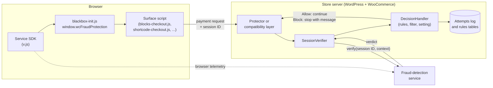
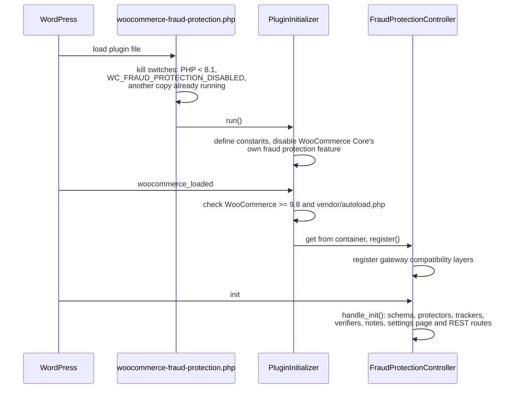
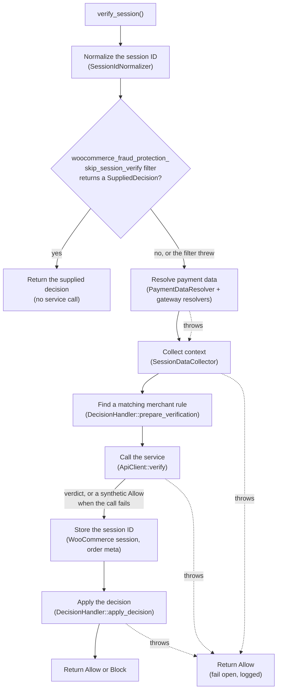
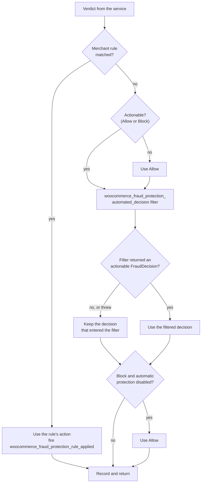
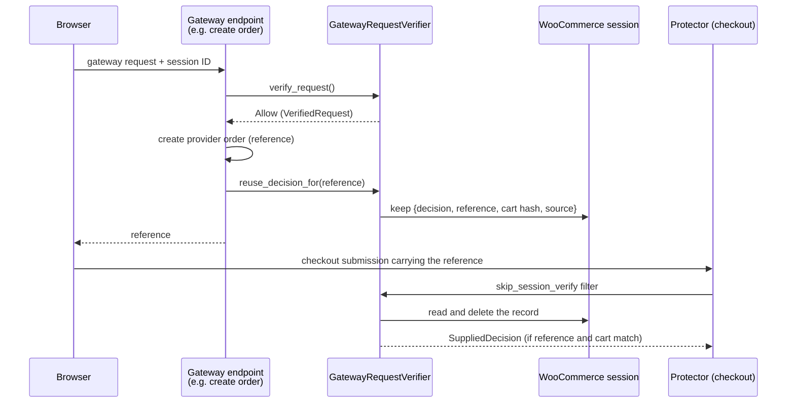
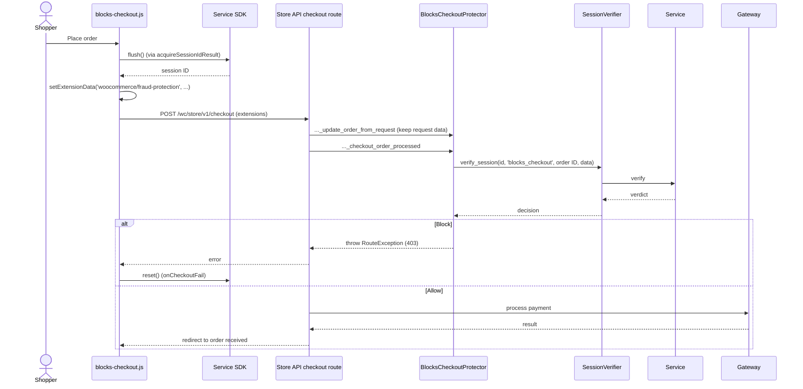
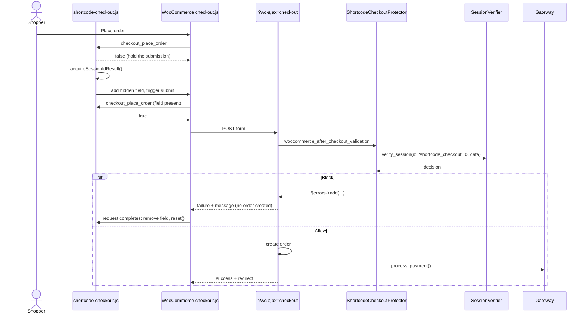

# 3. How Fraud Protection works

The first two chapters described WooCommerce's checkout and its payment gateways. This chapter puts the Fraud Protection plugin on top of them: what it does, where it hooks in, and how one payment attempt travels through it.

WooCommerce hook names link to the line where each hook runs in WooCommerce's code reference. The code reference is rebuilt for every WooCommerce release, so those lines move: if a link lands on unrelated code, look the hook up in the [WooCommerce hooks list](https://woocommerce.github.io/code-reference/hooks/hooks.html).

## Contents

- [What the plugin does](#what-the-plugin-does)
- [Key concepts](#key-concepts)
- [The big picture](#the-big-picture)
- [How the plugin starts](#how-the-plugin-starts)
- [The browser side: getting a session ID into the request](#the-browser-side-getting-a-session-id-into-the-request)
- [The server side: the protectors](#the-server-side-the-protectors)
- [The verification pipeline](#the-verification-pipeline)
- [From verdict to decision](#from-verdict-to-decision)
- [What happens after the decision](#what-happens-after-the-decision)
- [Attempts that span several requests](#attempts-that-span-several-requests)
- [Collecting context: the trackers](#collecting-context-the-trackers)
- [Reporting payment outcomes](#reporting-payment-outcomes)
- [The merchant side](#the-merchant-side)
- [Two attempts, end to end](#two-attempts-end-to-end)
- [The safety rules, and why they exist](#the-safety-rules-and-why-they-exist)

## What the plugin does

Fraud Protection checks each payment attempt with an external fraud-detection service, Blackbox, **before the payment reaches the gateway**. In short:

1. A browser script from the service runs on every page where the shopper can pay. It builds a *session* that describes the shopper's browser.
2. When the shopper submits a payment, the plugin's scripts add that session's ID to the request.
3. On the server, the plugin hooks into the request just before WooCommerce hands it to the gateway. It sends the session ID, along with the cart, customer and payment details, to the service.
4. The answer is a decision: allow or block. On a block, the plugin stops the request with a generic message. On an allow, WooCommerce continues as if the plugin weren't there.

Around that core, the plugin also:

- records each verified attempt in a local log that merchants can browse;
- lets merchants define their own allow and block rules;
- lets merchants turn automatic blocking off;
- reports payment outcomes, such as disputes, back to the service when an extension asks it to.

The plugin never touches card numbers, never changes how a gateway charges a card, and never holds a payment for review. It only decides whether an attempt may continue.

## Key concepts

| Term | Meaning |
|------|---------|
| **Payment attempt** | One try at paying: placing an order, paying an existing order, or saving a payment method. A shopper who fixes a typo and clicks **Place order** again makes a second attempt. |
| **Payment surface** | A page where an attempt can start: the checkout, the cart (express buttons), a product page (express buttons), the "Pay for order" page, and My Account > Add payment method. |
| **Session** and **session ID** | The service's description of one browser, built by its script (the *SDK*). The session ID identifies it in the verification request. One session ID is used for **one** attempt. |
| **Verification** | The server-side call that sends an attempt's session ID and context to the service and gets a verdict back. |
| **Source** | A short string naming the flow that asked for a verification, such as `blocks_checkout` or `pay_for_order`. It shows up in logs and in the attempts log. |
| **Decision** | A `FraudDecision`: `Allow` or `Block` are *actionable*. The service may return other values, which the plugin treats as `Allow`. |
| **Protector** | A plugin class that hooks one WooCommerce flow, verifies it, and enforces the decision. |
| **Compatibility layer** | A plugin class that does the same for one gateway's or extension's own flow. See [chapter 4](04-gateway-specific-flows.md). |
| **Fail open** | When something goes wrong, the attempt is allowed. A broken fraud check must never stop a legitimate payment. |

## The big picture

The SDK sends what it collects straight to the service; the store doesn't see it. The store's verification request carries the session ID, which ties the attempt to that session, along with the store's own context: the cart, customer and payment details, the visitor's IP address and request headers (see [the verification pipeline](#the-verification-pipeline)).

## How the plugin starts

The plugin can run as a regular plugin or as a must-use plugin on managed hosting. Either way, it starts in three steps:

Things to notice:

- **Nothing happens before WooCommerce loads.** The plugin needs WooCommerce's dependency-injection container, so it waits for [`woocommerce_loaded`](https://woocommerce.github.io/code-reference/files/woocommerce-includes-class-woocommerce.html#source-view.301).
- **Two registration moments.** Compatibility layers register at `woocommerce_loaded`, because some of the gateway hooks they need fire early. Everything else registers on WordPress [`init`](https://developer.wordpress.org/reference/hooks/init/).
- **Components get their dependencies from the container.** Each class has a `final public init()` method that the WooCommerce container calls with the dependencies, and a `register()` method that adds its hooks. [Architecture](../internals/architecture.md) has the details.

## The browser side: getting a session ID into the request

### Loading the scripts

On each payment surface, a protector asks `BlackboxScriptHandler::request_scripts()` for the shared scripts. It enqueues:

1. the service's SDK, `https://blackbox-api.wp.com/v1/dist/v.js` (handle `wc-fraud-protection-blackbox`);
2. `assets/js/blackbox-init.js` (handle `wc-fraud-protection-blackbox-init`), which configures the SDK and sets up `window.wcFraudProtection`.

It returns `false`, and the surface script is not loaded, when:

- the store isn't connected to WordPress.com through Jetpack (the service identifies the store by its Jetpack blog ID);
- the request can't render a payment surface: the admin, a REST request, an editor preview, the Customizer, or the order confirmation page.

The SDK starts working as soon as it loads, so the scripts load with the page where the shopper pays, not when the shopper submits.

### Adding the session ID to the request

Each surface has its own script, because each surface submits payments differently:

| Surface | Script | How it adds the session ID |
|---------|--------|----------------------------|
| Checkout block | `blocks-checkout.js` | Registers an [`onCheckoutValidation`](https://developer.woocommerce.com/docs/block-development/extensible-blocks/cart-and-checkout-blocks/checkout-payment-methods/checkout-flow-and-events/#oncheckoutvalidation) callback that waits for the session ID and stores it as Store API *extension data* under `woocommerce/fraud-protection` → `blackbox_session_id`. |
| Classic checkout | `shortcode-checkout.js` | Handles `checkout_place_order`: returns `false` to hold the submission, waits for the session ID, adds a hidden field, and submits the form again. |
| Pay for order | `pay-for-order.js` | Catches the form's `submit` event in the capture phase, before gateway scripts, waits for the session ID, adds a hidden field, and submits again. |
| Add payment method | `add-payment-method.js` | Same as pay for order. |
| Express buttons (WooPayments, Stripe) | `express-checkout.js` | Adds a prepared session ID through each gateway's synchronous extension-data filter. |
| PayPal buttons | `paypal-express.js` | Adds the session ID to PayPal Payments' own `fetch` requests. |
| Stripe on Add payment method | `stripe-add-payment-method.js` | Copies the form's session ID into Stripe's setup-intent AJAX request. |

All of them go through `window.wcFraudProtection`:

- `acquireSessionIdResult()` asks the SDK to send its latest data (`flush()`) and resolves to `{ sessionId, error }` within a few seconds. It **never rejects**: on a timeout or error, `sessionId` is empty and `error` says why.
- `prepareSessionId()` and `takePreparedSessionId()` keep a session ID ready for code that must add it synchronously, such as an express button's request builder.
- `reset()` starts a fresh session after an attempt has used the current one.

### One session ID per attempt

The plugin's contract with the service is that each session ID belongs to one payment attempt. So the scripts work hard to:

- take the ID **when the shopper submits**, not when the page loads;
- send each ID with **exactly one** request;
- start a fresh session after every attempt that used an ID, especially a failed one, where the shopper stays on the page and tries again.

Getting this wrong is a common source of bugs. A script that resets too early sends an ID that no longer matches the shopper's data; one that forgets to reset sends the same ID with two attempts. [Browser scripts](../internals/browser-scripts.md) walks through each script's lifecycle.

### When there's no session ID

Sometimes there's no session ID: a content blocker stopped the SDK, the SDK timed out, or a gateway script sent the request without waiting. The request still goes out. The plugin's scripts add the *reason* instead (`timeout`, `sdk_error`, `sdk_unavailable` or `not_ready`), in the `wc_fraud_protection_session_id_error` field or the `blackbox_session_id_error` extension key. A request that carries neither field didn't go through the plugin's scripts at all, and the server records `not_submitted`.

> **The server still verifies requests without a session ID.** A missing session ID is not proof of anything, and skipping verification would let anyone bypass the check by blocking one script.

## The server side: the protectors

Four protectors cover WooCommerce's own flows. Each one hooks the **last point before the gateway gets the payment**:

| Protector | Flow | Hook | Order exists? | How a block stops the flow |
|-----------|------|------|---------------|-----------------------------|
| `BlocksCheckoutProtector` | Checkout block, express buttons (Store API [`POST /wc/store/v1/checkout`](https://developer.woocommerce.com/docs/apis/store-api/resources-endpoints/checkout/#process-order-and-payment), and [`POST /wc/store/v1/checkout/{id}`](https://developer.woocommerce.com/docs/apis/store-api/resources-endpoints/checkout-order/) for existing orders) | [`woocommerce_store_api_checkout_order_processed`](https://woocommerce.github.io/code-reference/files/woocommerce-src-storeapi-routes-v1-checkout.html#source-view.695) | Yes, just set to `pending` | Throws a `RouteException` with HTTP 403 |
| `ShortcodeCheckoutProtector` | Classic checkout (`?wc-ajax=checkout`) | [`woocommerce_after_checkout_validation`](https://woocommerce.github.io/code-reference/files/woocommerce-includes-class-wc-checkout.html#source-view.1070), at `PHP_INT_MAX` | No | Adds an error to the [`WP_Error`](https://developer.wordpress.org/reference/classes/wp_error/) |
| `PayForOrderProtector` | "Pay for order" form | [`woocommerce_before_pay_action`](https://woocommerce.github.io/code-reference/files/woocommerce-includes-class-wc-form-handler.html#source-view.567) | Yes | [`wc_add_notice()`](https://woocommerce.github.io/code-reference/namespaces/default.html#function_wc_add_notice) with an error, which stops [`process_payment()`](https://woocommerce.github.io/code-reference/classes/WC-Payment-Gateway.html#method_process_payment) |
| `AddPaymentMethodProtector` | My Account > Add payment method | [`woocommerce_add_payment_method_form_is_valid`](https://woocommerce.github.io/code-reference/files/woocommerce-includes-class-wc-form-handler.html#source-view.648) filter | No order involved | Returns `false` and adds an error notice |

Why these hooks:

- **Blocks checkout.** The Store API creates or reuses the order, sets it to `pending`, fires `woocommerce_store_api_checkout_order_processed`, and *then* processes the payment. Throwing there stops the request before the gateway runs. The order stays `pending`, and WooCommerce reuses it if the shopper tries again with the same cart. The protector reads the request data one hook earlier, in [`woocommerce_store_api_checkout_update_order_from_request`](https://woocommerce.github.io/code-reference/files/woocommerce-src-storeapi-utilities-checkouttrait.html#source-view.254), because only that hook receives the [`WP_REST_Request`](https://developer.wordpress.org/reference/classes/wp_rest_request/).
- **Classic checkout.** [`WC_Checkout::process_checkout()`](https://woocommerce.github.io/code-reference/classes/WC-Checkout.html#method_process_checkout) validates the posted data, fires `woocommerce_after_checkout_validation` with a `WP_Error`, and creates the order only if there are no errors. Adding an error there means a blocked attempt never creates an order. The protector runs last (`PHP_INT_MAX`) and skips verification when another validator has already failed the checkout, because that attempt won't reach the gateway anyway.
- **Pay for order and add payment method.** [`WC_Form_Handler`](https://woocommerce.github.io/code-reference/classes/WC-Form-Handler.html) runs these hooks after its nonce check and before it calls the gateway, and it calls the gateway only when no error notice exists.

Each protector:

1. builds *request data*: the payment method (gateway ID), the gateway's own posted fields (`payment_data`), and the addresses;
2. reads the submitted session ID;
3. calls `SessionVerifier::verify_session()` with its source;
4. enforces a `Block` with the error mechanism of its flow, and the generic message from `BlockedSessionMessage`.

The message is always generic: "We are unable to process this request online", followed by a support email address when the store has one. It never mentions fraud.

## The verification pipeline

`SessionVerifier::verify_session( $session_id, $source, $order_id, $request_data )` is the one place where verification happens. Every protector and compatibility layer calls it, and it **never throws**.

Step by step:

1. **Normalize the session ID.** The submitted value is untrusted mixed input. A valid string passes through; anything else becomes an invalid marker such as `wcfp-invalid-array`, so the service can tell a malformed value from a missing one.
2. **Ask whether the decision is already known.** The `woocommerce_fraud_protection_skip_session_verify` filter lets a callback return a `SuppliedDecision`. This is how an attempt that was verified in an earlier request reuses that decision (see [Attempts that span several requests](#attempts-that-span-several-requests)). Only an actionable decision skips the call.
3. **Resolve the payment data.** `PaymentDataResolver` turns the gateway's posted fields into a `PaymentMethodData`: gateway, payment type, card brand, last four digits, and so on. It starts from the saved WooCommerce payment token when there is one, then runs the `woocommerce_fraud_protection_resolved_payment_data` filter, where gateways and compatibility layers fill in the rest. A failure here leaves the payment data empty but doesn't stop the verification.
4. **Collect the context.** `SessionDataCollector` gathers the store and plugin versions, the shopper's session, the customer and their addresses, the order or cart, and the events the trackers recorded. When there's no session ID, the verifier adds the reason.
5. **Match merchant rules.** Before calling the service, the plugin finds the first active merchant rule that matches the attempt. The service is still called, so the attempt is recorded with the service's verdict too.
6. **Call the service.** `ApiClient::verify()` sends the context to the service through a signed Jetpack Connection request, with a 3-second timeout. Transport errors, timeouts, unreadable responses and unknown decisions all become a synthetic `Allow`, which still goes through step 8. So a matching merchant block rule is enforced even when the service can't be reached, and the attempt is recorded with the `verify_error` trigger.
7. **Store the session ID.** The session ID the service returns is saved in the WooCommerce session and, when the order exists, in the order meta `_wc_fraud_protection_session_id`. Later reports use it to tie the order to the attempt.
8. **Apply the decision.** See the next section.

## From verdict to decision

`DecisionHandler::apply_decision()` turns the service's verdict into the decision that is enforced:

The order matters:

- **Merchant rules win.** A rule is the merchant's explicit choice, so it overrides the service, the filter and the automatic-protection setting. A block rule blocks even when automatic protection is off.
- **The filter can override automated decisions only.** Extensions use `woocommerce_fraud_protection_automated_decision` to allowlist trusted customers, for example. If a callback throws or returns garbage, the decision that entered the filter stands. An error must not turn a block into an allow, nor create a new block.
- **Automatic protection is the last switch.** When a merchant turns automatic blocking off, automated blocks become allows, but they're still recorded as blocks, so the merchant can see what would have happened.

## What happens after the decision

- **The protector enforces it.** A `Block` stops the request; an `Allow` lets WooCommerce continue to the gateway.
- **The attempt is recorded.** `SessionEventRecorder` writes a row to the `wc_fraud_protection_sessions` table: the decision received, the final status, the trigger (`blackbox`, `verify_error`, `request_rejected`, `allow_rule` or `block_rule`), and a few customer fields for the merchant's attempts list. A supplied decision skips the call and records nothing, and nothing is recorded while the database schema isn't installed.
- **The session ID follows the order.** For the classic checkout, the order doesn't exist yet at verification time, so the session ID waits in the WooCommerce session and `SessionVerifier::persist_session_id_to_order()` copies it to the order on [`woocommerce_checkout_order_created`](https://woocommerce.github.io/code-reference/files/woocommerce-includes-class-wc-checkout.html#source-view.521).
- **Nothing else persists.** A block doesn't follow the shopper. The next attempt is verified from scratch. The plugin doesn't empty the cart, hold the order, or keep a list of blocked shoppers.

## Attempts that span several requests

Some payment flows don't fit in one request. The shopper's browser first talks to the gateway through the gateway's own endpoint, and only later submits the WooCommerce form:

- **PayPal** creates a PayPal order through an AJAX request when the shopper clicks the PayPal button. The WooCommerce checkout that completes the purchase comes later.
- **Stripe on Add payment method** creates and confirms a *setup intent* in its own AJAX request, before the form post. Confirming it already sends the card to the issuer, so verifying only the final form post would be too late.

The plugin verifies the first request, because that's the last point before the card reaches the network. The final submission still runs through its protector. Verifying it again would score the same attempt twice, and it would also need a second session ID that the browser no longer has. So the first request *keeps* its decision, and the final submission *reuses* it:

The rules that keep this safe:

- **The record belongs to one attempt.** A matching submission uses it once and deletes it, and a submission whose cart items changed is verified instead. A submission with the same source as the request that kept the decision never reuses it.
- **The evidence comes from the server.** The reference must be a value the gateway's server created while handling the verified request, such as a PayPal order ID. A query parameter or form field that only *claims* the attempt was verified proves nothing.
- **A failure to reuse means verifying again,** never allowing by default.

`GatewayRequestVerifier` is the public version of this mechanism for gateways. The PayPal and Stripe compatibility layers have their own single-use records, bound to the evidence their flows offer: the PayPal order, or the session ID, user and payment method of a Stripe setup intent. [Compatibility layers](../internals/compatibility-layers.md) has the details.

## Collecting context: the trackers

Between page loads, three trackers record shopper activity into the WooCommerce session, so the next verification can include it:

| Tracker | Records |
|---------|---------|
| `CartEventTracker` | Items added, updated, removed and restored; cart page loads. |
| `CheckoutEventTracker` | Checkout page loads; field updates from both checkouts; orders placed. Clears the events once an order is paid. |
| `PaymentMethodEventTracker` | Add-payment-method page loads; payment tokens saved. |

`SessionDataCollector::collect()` stores the events, keeping the most recent ones. `SessionIdentityManager` keeps a first-party identity cookie, `wfp_id`, that lasts for the browser session and is passed to the SDK when it's configured.

## Reporting payment outcomes

Some outcomes only become known after the attempt: a payment is captured, a card is declined, a dispute is opened or won. `FraudProtectionReporter::report()` lets a gateway send such an outcome to the service for an order that went through a verification. It reads the session ID from the order meta, sends a normalized `ReportContextData`, and logs and ignores any failure. Reporting never affects order processing. The [API reference](../api-reference.md#fraudprotectionreporter) documents it.

## The merchant side

When the merchant-facing features are enabled, the plugin adds:

- a **Fraud prevention** tab under WooCommerce > Settings, a React app in `client/` compiled into `build/`;
- the **automatic protection** toggle, stored in `woocommerce_fraud_protection_automatic_protection`;
- the **checkout attempts** list, read from the sessions table through `GET /wc-admin/fraud-protection/sessions`;
- **merchant rules**: allow or block by email or IP address, stored in the rules table and managed through `/wc-admin/fraud-protection/rules`;
- admin notes in the WooCommerce Inbox.

[Admin and operations](../internals/admin-and-operations.md) covers these pieces.

## Two attempts, end to end

### Checkout block

### Classic checkout

## The safety rules, and why they exist

[AGENTS.md](../../AGENTS.md#safety-rules) lists the rules every change must follow. Here is the reasoning behind them.

### Fail open

A fraud check that fails closed turns every outage, timeout or bug into lost sales for every store that runs the plugin. So:

- any error before an actionable decision exists produces `Allow`;
- an independent step that fails (for example, payment-data resolution) doesn't stop the steps that can still produce a decision;
- missing data, including a missing session ID, never skips verification by itself.

The reverse also holds: an error **after** a block exists must not turn it into an allow. That's why a throwing `automated_decision` filter keeps the decision that entered it.

### Treat everything as mixed input

Hook arguments come from other plugins, and request fields come from the browser. Even when a hook documents a type, a third-party callback can return anything. The plugin checks types before using values, and on bad input it keeps the original safe value or skips only the bad field.

### One decision per attempt

A decision applies to the attempt that produced it. The plugin never stores state that blocks a shopper's *next* attempt, never adds store-wide gates, and never empties the cart. When a flow spans several requests, a bounded, single-use record carries the decision across them, keyed to evidence the plugin or the gateway's server produced.

A protector that verified earlier in the same attempt must return the decision it got. Skipping a later verification must not turn a previous block into an allow.

### Trust only the plugin's own evidence

To skip a verification, the plugin needs evidence it produced itself: a value it stored in the server-side session, or a reference the gateway's server created. A request field that says "already verified" is attacker-controlled.

### Don't reveal the fraud check

Shoppers see a generic message. Logs that leave the store go through `LogContextSanitizer`. Source comments, commit messages and pull requests don't describe how the service decides.

## Next

[Chapter 4](04-gateway-specific-flows.md) covers the flows where a gateway or another extension takes the payment outside WooCommerce's own forms, and how the plugin protects them.
